# AMAT5315: Scientific Computing for Physicists - Weekly Exercises

This repository stores weekly exercises for AMAT5315 (*Scientific Computing for Physicists*). Each week contains complete source code, verification test suites, evidence figures, and interactive web laboratories.

- **Weekly Exercise Directories**:
  - [`week1/`](week1/): Monte Carlo $\pi$ Estimator & AI Agent Workflows
  - [`week2/`](week2/): 2D Lennard-Jones Molecular Dynamics & Spatial Partitioning
  - [`week3/`](week3/): 2D Ising Lattice Model & Zero-Temperature Metropolis MCMC
  - [`week4/`](week4/README.md): Pseudospectral Continuum Fluid Dynamics (Navier–Stokes & Taylor–Green)
  - [`week5/`](week5/README.md): Acoustic Wave Simulation, Automatic Differentiation & Binomial Checkpointing
  - [`week6/`](week6/README.md): Energy-Based Models (RBM, Classical Hopfield & Softmax Attention)
  - [`week7/`](week7/README.md): Diffusion Models & Flow Matching (DDPM, DDIM, pretrained CIFAR-10 U-Net, RePaint)
  - [**`week8/` (Latest)**](week8/README.md): **Language Models & the Transformer (embeddings, n-grams, memory, attention, Chinchilla scaling)**

- **Interactive GitHub Pages Web Labs**:
  - [Week 1: AI Agents & Monte Carlo $\pi$ Lab](https://imgrj.github.io/AMAT5315-2026Fall-Exercise/week1-pi-lab.html)
  - [Week 2: Molecular Dynamics Simulation Studio](https://imgrj.github.io/AMAT5315-2026Fall-Exercise/index.html)
  - [Week 3: Ising Lattice Lab](https://imgrj.github.io/AMAT5315-2026Fall-Exercise/week3-ising-lab.html)
  - [Week 4: Continuum Fluid Dynamics Lab](https://imgrj.github.io/AMAT5315-2026Fall-Exercise/week4-fluid-lab.html)
  - [Week 5: Seismic & Automatic Differentiation Lab](https://imgrj.github.io/AMAT5315-2026Fall-Exercise/week5-seismic-lab.html)
  - [Week 6: Energy-Based Models & Softmax Attention Lab](https://imgrj.github.io/AMAT5315-2026Fall-Exercise/week6-energy-lab.html)
  - [**Week 7: Diffusion & Flow Matching Lab**](https://imgrj.github.io/AMAT5315-2026Fall-Exercise/week7-diffusion-lab.html)
  - [**Week 8: Language Models & Transformer Lab**](https://imgrj.github.io/AMAT5315-2026Fall-Exercise/week8-language-lab.html)

---

## Week 8: Language Models and the Transformer (Latest Exercise)

The complete six-part learning sheet: pretrained embedding geometry; TinyStories count models; linear and nonlinear memory capacity; softmax picture recall; a JAX transformer trained from scratch; and a bootstrap refit of Chinchilla scaling.

- **Guide and reproduction commands:** [week8/README.md](week8/README.md)
- **Interactive Studio and 14 evidence figures:** [Week 8 Language Lab](https://imgrj.github.io/AMAT5315-2026Fall-Exercise/week8-language-lab.html)
- **Verification:** 34 independent tests, 49 full-experiment acceptance checks and deliberate negative controls.

| Result | Measured evidence |
| :--- | :--- |
| Word relations become directions | Mean cosines 0.466 / 0.549 / 0.433; shuffled controls near zero |
| Count models reach a data limit | 4-gram 1.310 bits/character; 6-gram falls to 1.793 |
| MLP learns the bigram table | Loss difference +0.00495 nats/token |
| Attention recalls among 4,096 pictures | Softmax interference/signal 0.057 |
| Transformer beats all count models | **1.220 bits/character** after 6,000 CPU updates |
| Compute-optimal scaling | α=0.3473, β=0.3672; **17.9 tokens/parameter**, 95% interval 7.4–35.4 |

| Same validation stories, better predictions | Attention suppresses unrelated memories |
| :---: | :---: |
|  |  |

| Word relations as directions | Refit the compute-optimal allocation |
| :---: | :---: |
|  |  |

The guide lists pinned downloads and one command beside each figure. Raw data and model checkpoints stay out of Git.

---

## Week 7: Diffusion and Flow Matching

Generation by transporting fresh Gaussian noise, following the revised learning sheet's Algorithms 1-6: DDPM on a four-cluster mixture (Parts 1), deterministic DDIM (Part 2), flow matching and the sampling-cost comparison (Part 3), a JAX port of a pretrained CIFAR-10 noise predictor (Part 4), and RePaint inpainting (Part 5).

- **Full Documentation & Reproduction Guide**: [**`week7/README.md`**](week7/README.md)
- **Live Interactive Lab (runs the trained network in the browser)**: [**Week 7 Diffusion Lab**](https://imgrj.github.io/AMAT5315-2026Fall-Exercise/week7-diffusion-lab.html)
- **Configuration**: [`week7/diffusion.toml`](week7/diffusion.toml) and [`week7/flow.toml`](week7/flow.toml) pin the architecture, optimizer, seeds and checkpoint list.

### Key Results & Evidence Gallery

#### 1. DDPM on the Gaussian mixture (Algorithms 1-2)
- **Forward diffusion**: at `t = 1000` the per-coordinate mean is `(-0.0064, 0.0070)` and the variance `(0.977, 1.021)`, within the required 0.1 of the standard Gaussian.
- **Training**: 25,000 updates, batch 512, Adam with a cosine decay to zero, seed 2026; checkpoints at `0, 50, 100, 200, 500, 1000, 2000, 5000, 10000, 25000`. The loss plateaus at **0.2316**, near the reference 0.25, because the added noise is still uncertain given the noisy point (Eq. 14).
- **Generation** (2000 samples, 1000 steps): populations 0.2555/0.2675/0.2295/0.2475 (allowance 0.04), spreads 0.281-0.321 (allowance 0.03), largest centre error **0.040** (allowance 0.05). Denoiser control: 0.042/0.034/0.022 posterior standard deviations at `t = 100, 300, 600`, 0.243 at `t = 900`.

#### 2. Deterministic DDIM (Algorithm 3)
- Two DDIM runs over 1000 levels differ by **exactly 0**; two DDPM runs share their final cluster 23.5% of the time, the chance rate.
- DDIM populations 0.2450-0.2615 (within 0.015 of 0.25); widths at most **0.311**, with 0.310 for the same starts under exact conditional-mean noise and 0.307 for exact target draws, so the whole band `[0.29, 0.32]` holds.

#### 3. Flow matching and fewer steps (Algorithms 4-5)
- **Learned marginal velocity**: relative RMS error **0.020, 0.026, 0.066** at `s = 0.1, 0.5, 0.9` (requirement < 0.1).
- **Step-count sweep** (4000 samples per run, null 95% quantile 0.0038): flow matching reaches energy distance **0.0023 at 20 steps** (requirement < 0.005) with width error 0.019; DDIM reaches 0.0027 at 20 levels; DDPM is accurate from about twenty levels in this run and was the slowest in the reference. One or two steps collapse toward the mean for every sampler.

#### 4. The downloaded predictor on photographs
- **Port verification**: the JAX re-implementation of the diffusers v0.40.0 `UNet2DModel` matches the reference predictions to **7.15e-6** on six fixed inputs; 35,746,307 parameters (about 35.7M).
- **Generation**: four images from Gaussian noise with Algorithm 2 unchanged, unclipped; structure appears between `t = 200` and `t = 50`. Weights learned before the download; the reverse updates are computed here.

#### 5. RePaint inpainting (Algorithm 6)
- **Observed pixels**: hidden square rows/columns 6:26, 99 network evaluations per completion; the largest change of an observed pixel is **0.0** (requirement < 1e-5).
- **Hidden content**: mean hidden-pixel MSE **0.221** over 16 completions (reference 0.24), differing between seeds inside the hole; the variance map shows where the observation leaves the content undetermined.

| Trained DDPM recovers the four clusters | Flow matching and DDIM in tens of steps |
| :---: | :---: |
|  | 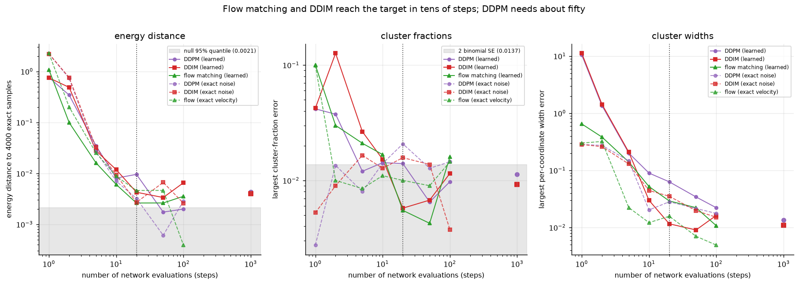 |

| Downloaded CIFAR-10 predictor | RePaint keeps every observed pixel |
| :---: | :---: |
| 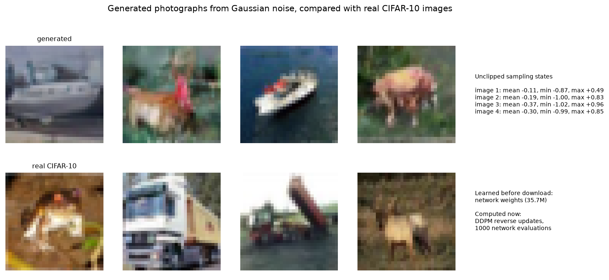 | 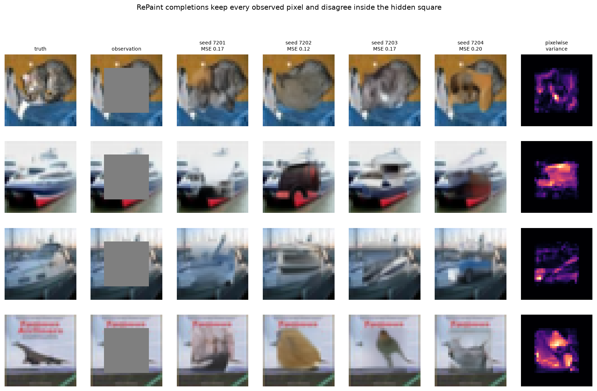 |

### Quick Reproducibility Commands

From `week7/` (CPU):
```powershell
python scripts/part1_forward.py        # Part 1 first task: target + forward diffusion only
python scripts/part1_diffusion.py      # Algorithms 1-2: training, DDPM, figures (~4 min)
python scripts/part2_ddim.py           # Algorithm 3 (~1 min)
python scripts/part3_flow.py           # Algorithms 4-5 and the step sweep (~6 min)
python scripts/part4_cifar.py          # pretrained CIFAR-10 DDPM, four images (~13 min)
python scripts/part5_inpaint.py        # Algorithm 6 (~4.5 min)
python -m pytest tests -q              # 35 verification tests
```

---

## Week 6: Energy-Based Models

Comprehensive implementation, verification, and empirical study of energy-based probabilistic generative models and associative memories:

- **Full Documentation & Reproduction Guide**: [**`week6/README.md`**](week6/README.md)
- **Live Interactive Simulator & Evidence Lightbox**: [**Week 6 Interactive Web Lab**](https://imgrj.github.io/AMAT5315-2026Fall-Exercise/week6-energy-lab.html)

### Key Results & Evidence Gallery

#### 1. Datasets & Native Pixels
- **MNIST**: $28 \times 28$ grayscale pixels ($60k$ train, $10k$ test). Digit `1` is most frequent ($11.24\%$), digit `5` least frequent ($9.03\%$).
- **CIFAR-10**: $32 \times 32$ RGB images ($50k$ train, $10k$ test). Exactly $5,000$ train and $1,000$ test images per class (balanced $0.1000$ fraction).

| MNIST Native Pixels & Class Frequencies | CIFAR-10 Native Pixels & Balanced Splits |
| :---: | :---: |
| 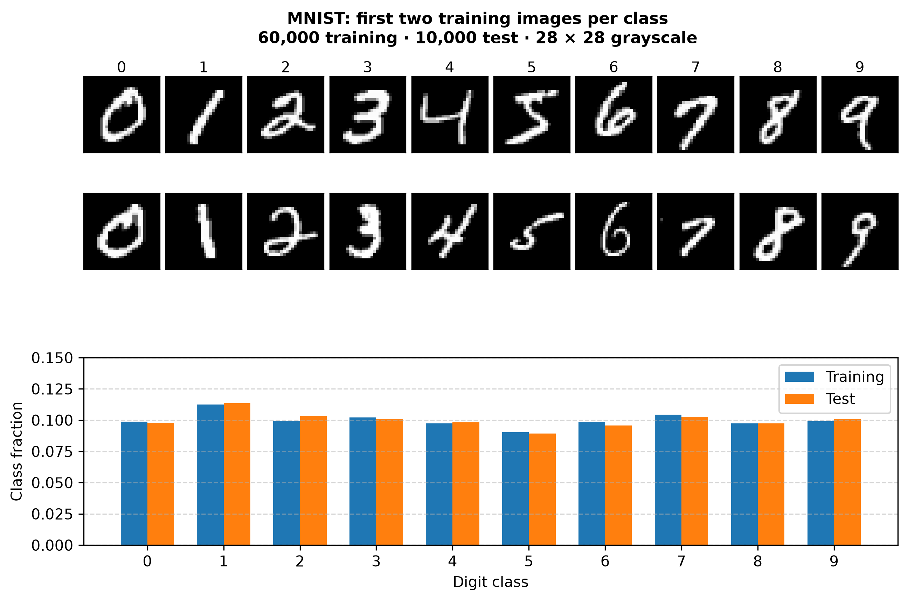 | 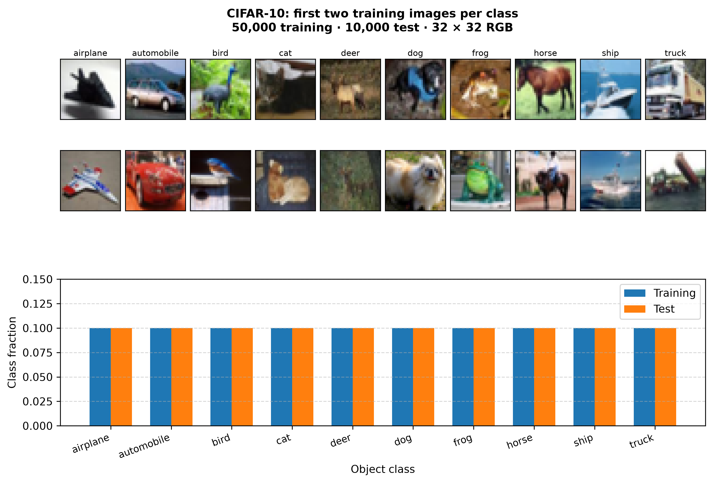 |

#### 2. Restricted Boltzmann Machine (RBM)
- **Visible Spins**: Pixels binarized at half intensity ($v_i \in \{0, 1\} \implies s_i = 2v_i - 1 \in \{-1, +1\}$).
- **CD-1 vs CD-10 Training**: Trained with automatic differentiation of free-energy differences and `stop_gradient` on 128 hidden units across 20 epochs.
  - Held-out one-step reconstruction error dropped from $49.96\%$ to **$4.77\%$** (CD-1) and **$4.95\%$** (CD-10).
- **Generation from Random Spins**: Pure noise evolves through Gibbs sweeps into connected strokes and coherent digit contours.
- **Clamped Image Completion**: Upper half clamped, lower half sampled; ink overlap $2|A \cap B|/(|A|+|B|)$ on 64 test digits exceeds wrong-upper-half conditioning by **$+0.167$** (CD-1) and **$+0.202$** (CD-10), far exceeding the required $0.10$ margin.

| RBM Training Learning Curves | Fresh Generation from Random Spins |
| :---: | :---: |
| 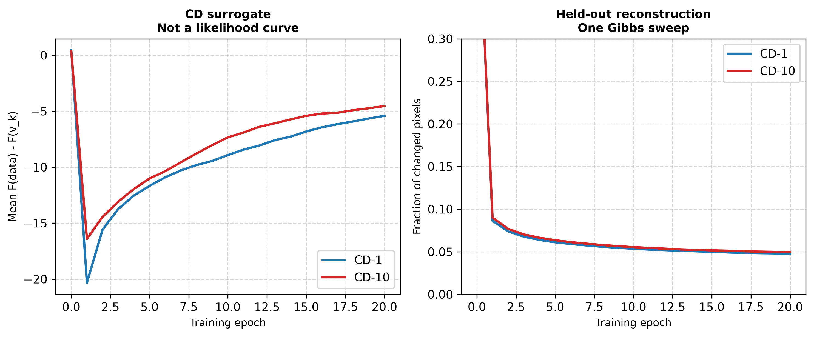 | 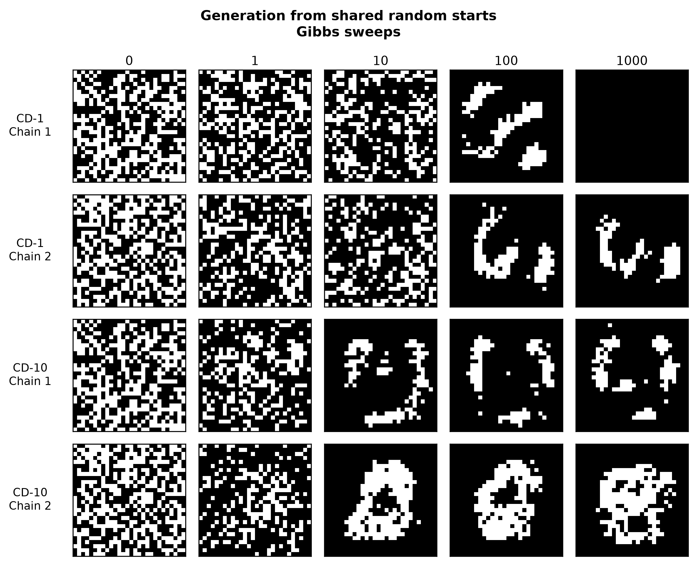 |

| Clamped Gibbs Image Completion | Quantitative Ink Overlap vs Sweeps |
| :---: | :---: |
| 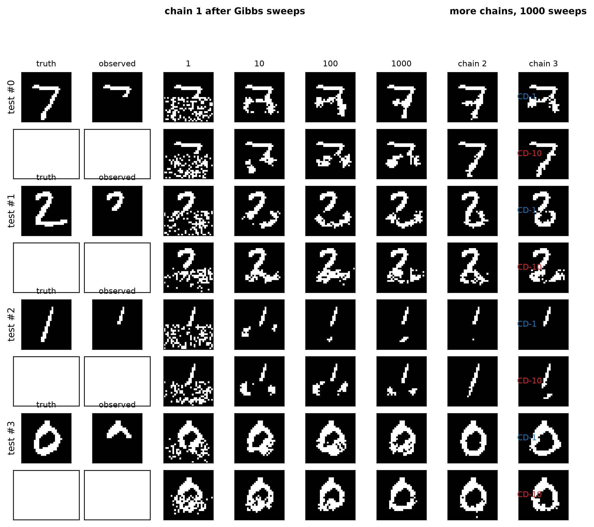 | 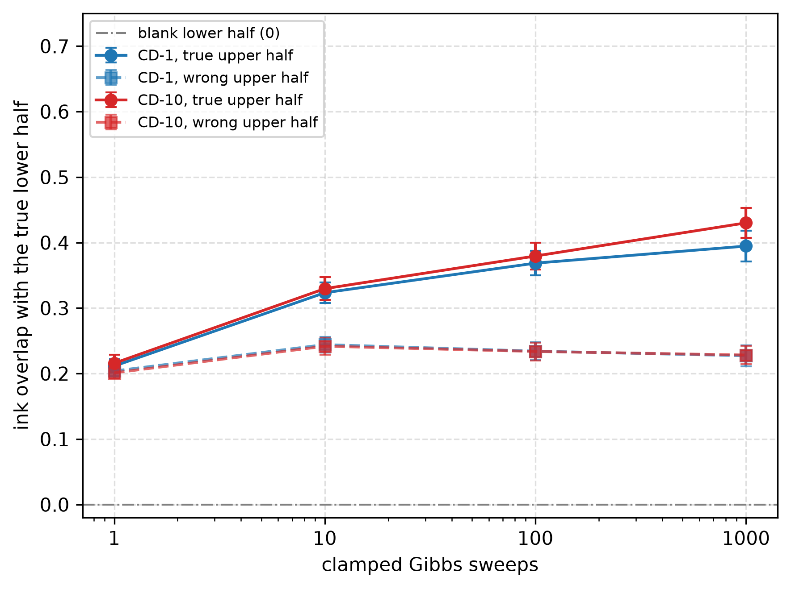 |

#### 3. Classical Hopfield Network & Capacity Collapse
- **Hebbian Couplings & Crosstalk**: Stored $P$ random patterns with $J_{ij} = \frac{1}{N}\sum_\mu \xi_i^\mu \xi_j^\mu$ ($J_{ii}=0$).
  - Unstable bit fraction follows Gaussian crosstalk prediction $\Phi(-1/\sqrt{\alpha})$ with finite-$N$ correction $\Phi(-\sqrt{\frac{N-1}{P-1}})$.
- **Storage Capacity Phase Transition**: Zero-temperature asynchronous recall sweeps demonstrate storage capacity collapse toward Amit-Gutfreund-Sompolinsky limit $\alpha_c \approx 0.138$.
  - Crossing points ($m < 0.90$): $N=100 \implies 0.175$, $N=200 \implies 0.166$, $N=400 \implies 0.154$, $N=800 \implies 0.146$ (all within $0.011$ of reference).

| Hopfield Unstable Bits vs Crosstalk | Storage Capacity & Recall Collapse |
| :---: | :---: |
| 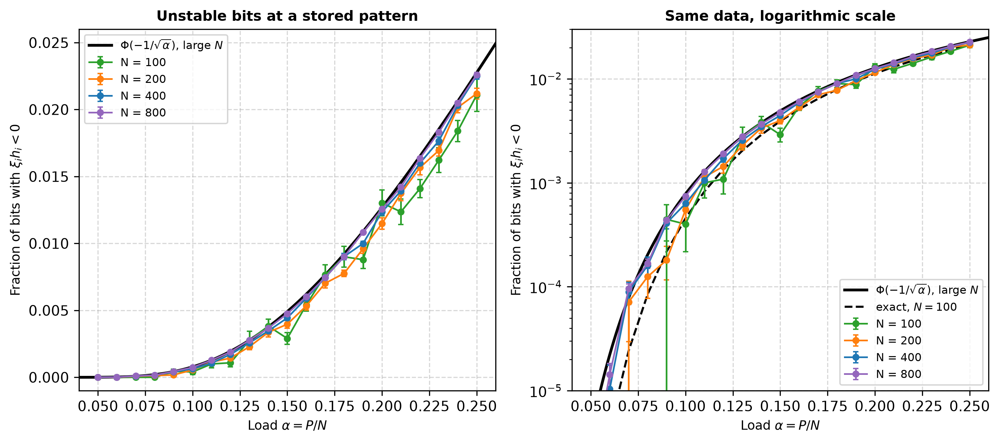 | 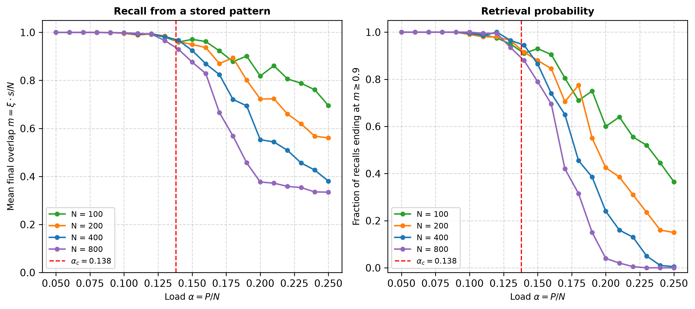 |

#### 4. Modern Hopfield Network & Softmax Attention Equivalence
- **Exact Transformer Attention Identity**: The modern update $x \leftarrow X \mathrm{softmax}(\beta X^T x)$ mathematically matches scaled dot-product attention:
  $$\mathrm{Attention}(q, K, V) = V^T \mathrm{softmax}(\beta K q)$$
  Measured maximum absolute difference with `jax.nn.dot_product_attention` is **$1.31 \times 10^{-6}$** ($< 10^{-5}$).
- **Temperature-Controlled Retrieval**:
  - $\beta \le 0.01$: diffuse average of all stored digits.
  - $\beta = 0.03$: target digit features emerge from background.
  - $\beta \ge 0.1$: sharp single-step memory retrieval.
- **Correlated Digit Capacity**:
  - Classical Hebbian recall achieves **$0.0\%$** success for all $P \in \{3, 10, 30, 100, 300, 1000\}$ due to high background correlations ($87\%$ background pixels).
  - Modern Hopfield ($\beta = 0.3$) achieves **$95\% \sim 100\%$** retrieval success across all $P$ up to $1000$.

| Softmax Weights across Temperature $\beta$ | Retrieval Transition Gallery across $\beta$ |
| :---: | :---: |
| 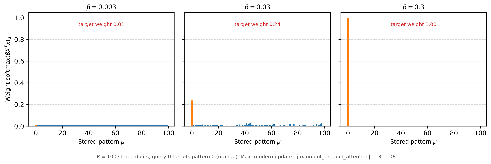 | 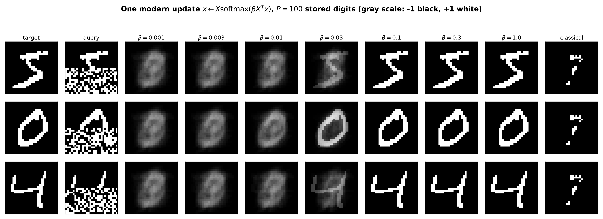 |

| Capacity: Modern vs Classical on Digits | Modern Hopfield Retrieval Gallery ($P=100$) |
| :---: | :---: |
| 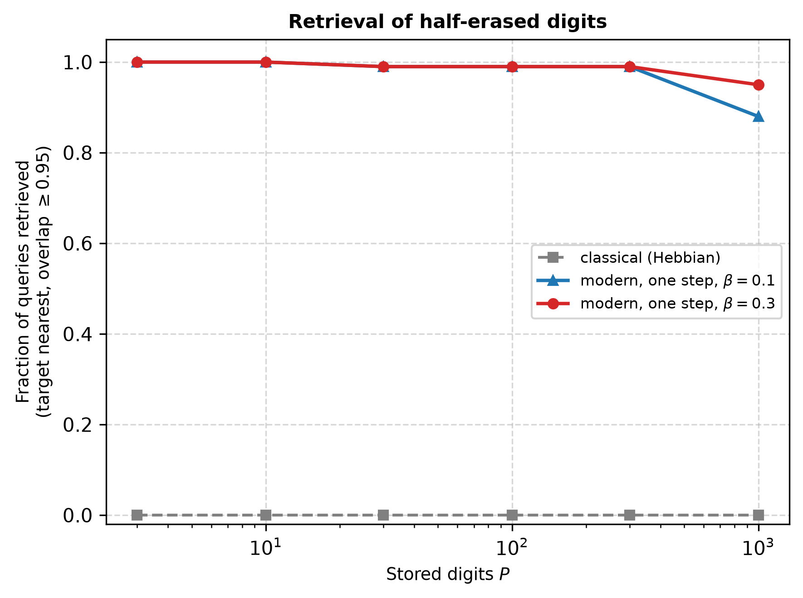 | 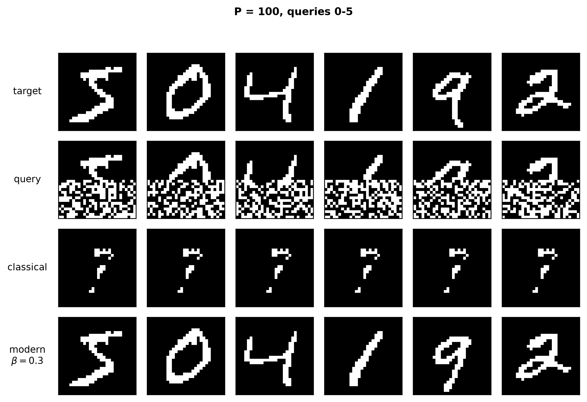 |

### Quick Reproducibility Commands

From `week6/`:
```bash
# Part 1: Datasets inspection
python scripts/part1_datasets.py

# Part 2: RBM CD-1 / CD-10 training, generation & completion
python scripts/part2_rbm.py

# Part 3: Classical Hopfield crosstalk & capacity sweeps
python scripts/part3_hopfield.py

# Part 4: Modern Hopfield attention equivalence & correlated digit benchmark
python scripts/part4_modern_hopfield.py
```

---

## Week 1: AI Agents & Monte Carlo $\pi$ Estimator

Week 1 contains `pi.py`, a Monte Carlo estimator of $\pi$ using pseudo-random dart throws in the unit square, along with `test_pi.py`.

```bash
python3 -m pytest week1/
```

Expected output:
```
estimate=3.146604, absolute error=0.005011
```

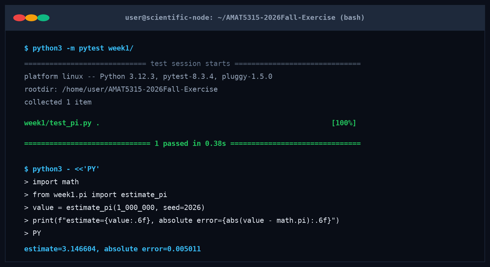
