# AMAT5315: Scientific Computing for Physicists - Weekly Exercises

This repository stores weekly exercises for AMAT5315 (*Scientific Computing for Physicists*). Each week contains complete source code, verification test suites, evidence figures, and interactive web laboratories.

- **Weekly Exercise Directories**:
  - [`week1/`](week1/): Monte Carlo $\pi$ Estimator & AI Agent Workflows
  - [`week2/`](week2/): 2D Lennard-Jones Molecular Dynamics & Spatial Partitioning
  - [`week3/`](week3/): 2D Ising Lattice Model & Zero-Temperature Metropolis MCMC
  - [`week4/`](week4/README.md): Pseudospectral Continuum Fluid Dynamics (Navier–Stokes & Taylor–Green)
  - [`week5/`](week5/README.md): Acoustic Wave Simulation, Automatic Differentiation & Binomial Checkpointing
  - [`week6/`](week6/README.md): Energy-Based Models (RBM, Classical Hopfield & Softmax Attention)
  - [`week7/`](week7/README.md): Diffusion Models & Flow Matching (DDPM, DDIM, pretrained CIFAR-10 U-Net, RePaint)
  - [`week8/`](week8/README.md): Language Models & the Transformer (embeddings, n-grams, memory, attention, Chinchilla scaling)
  - [`week9/`](week9/README.md): Probabilistic Inference by Tensor Contraction (ASIA, contraction orders, loopy BP, Promedus_14)
  - [**`week10/`**](week10/README.md): Approximate Tensor Contraction for the Ising Model (truncated SVD, boundary MPS, TRG, specific-heat peaks)
  - [**`week11/`**](week11/README.md): Hard Problems, Reductions & Tensor-Network Sampling (gate gadgets, tropical contraction, Boltzmann sampling, N-queens as a tensor network)
  - [**`week12/` (Latest)**](week12/README.md): **Integer Programming and Learned Branching (spin-glass MILP, exact Branch-and-Bound, Strong Branching, imitation learning)**

- **Interactive GitHub Pages Web Labs**:
  - [Week 1: AI Agents & Monte Carlo $\pi$ Lab](https://imgrj.github.io/AMAT5315-2026Fall-Exercise/week1-pi-lab.html)
  - [Week 2: Molecular Dynamics Simulation Studio](https://imgrj.github.io/AMAT5315-2026Fall-Exercise/index.html)
  - [Week 3: Ising Lattice Lab](https://imgrj.github.io/AMAT5315-2026Fall-Exercise/week3-ising-lab.html)
  - [Week 4: Continuum Fluid Dynamics Lab](https://imgrj.github.io/AMAT5315-2026Fall-Exercise/week4-fluid-lab.html)
  - [Week 5: Seismic & Automatic Differentiation Lab](https://imgrj.github.io/AMAT5315-2026Fall-Exercise/week5-seismic-lab.html)
  - [Week 6: Energy-Based Models & Softmax Attention Lab](https://imgrj.github.io/AMAT5315-2026Fall-Exercise/week6-energy-lab.html)
  - [Week 7: Diffusion & Flow Matching Lab](https://imgrj.github.io/AMAT5315-2026Fall-Exercise/week7-diffusion-lab.html)
  - [Week 8: Language Models & Transformer Lab](https://imgrj.github.io/AMAT5315-2026Fall-Exercise/week8-language-lab.html)
  - [Week 9: Probabilistic Inference & Tensor Network Lab](https://imgrj.github.io/AMAT5315-2026Fall-Exercise/week9-inference-lab.html)
  - [Week 10: Approximate Tensor Contraction & Ising Lab](https://imgrj.github.io/AMAT5315-2026Fall-Exercise/week10-tensor-lab.html)
  - [Week 11: Hard Problems & Tensor-Network Sampling Lab](https://imgrj.github.io/AMAT5315-2026Fall-Exercise/week11-tnsample-lab.html)
  - [**Week 12: Integer Programming & Learned Branching Lab**](https://imgrj.github.io/AMAT5315-2026Fall-Exercise/week12-branching-lab.html)

> The weekly navigation bar is one shared component: `python tools/fix_week_nav.py` writes the same
> `<nav>` block into every lab page — the same 12 links in the same order, the same labels, the same
> styling (carried inside the block, so a page's own CSS cannot change it) and the current page
> highlighted. It also repairs the navs that live inside builders, so regenerating a lab cannot bring
> an older bar back. Run it after adding or renaming a week's page.

---

## Week 12: Integer Programming and Learned Branching (Latest Exercise)

The sheet's four builds: a spin glass written as a mixed-integer linear program for HiGHS, with its LP relaxation, integrality gap and rounding excess; exact Branch-and-Bound comparing a cheap branching rule with Strong Branching; a small network trained by imitation learning to copy Strong Branching inside the same exact search; and a measurement of whether the smaller trees are actually faster on a laptop, including transfer to larger spin glasses. One Rust tool, `branchopt`, with HiGHS compiled from source; Python only for the figures, the JAX trainer, tests and the browser check.

- **Guide and reproduction commands:** [week12/README.md](week12/README.md)
- **Interactive Studio and 4 evidence figures:** [Week 12 Branching Lab](https://imgrj.github.io/AMAT5315-2026Fall-Exercise/week12-branching-lab.html)
- **Verification:** 69 independent tests, 42 acceptance checks and seven recorded negative controls.

| Result | Measured evidence |
| :--- | :--- |
| Opening four-spin square | LP bound **−4.000000**, exact **−2.000000** (matches `pred`), nearest rounding **+2.000000** |
| Two-food diet LP | **23.071429** = 323/14 at (89/28, 8/7) |
| 16 × 22-spin, 52-bond, seed 2026 | every LP bound **−52.00**; mean exact **−38.25**; mean gap **13.75** (36.4 %); rounding suboptimal on **16/16**, mean excess 34.25, up to 60 on instance 11 |
| Frustrated tetrahedron | **5 nodes** instead of 7, LP bounds −6, −4, −3, −3, −2 |
| 48 spin glasses, most-frac / Strong Branching | **52.79 → 16.96** mean nodes (3.11× smaller) at **1.00 → 18.11** LP solves per node; both exact to **6.5 × 10⁻¹³** |
| Imitation learning | 290 training / 93 validation nodes, **zero instance overlap**; validation cross-entropy **1.833**; JAX↔Rust probe agreement **6.7 × 10⁻¹⁶** |
| 16 unseen 22-spin graphs | mean nodes **50.63 → 14.50** (neural, 5.60 ms) against **15.50** for Strong Branching (91.30 ms); largest error **2.0 × 10⁻¹²** |
| 8 larger 30-spin, 72-bond graphs | **175.25 → 44.25** nodes without retraining; neural **55.66 ms** against Strong Branching's **861.68 ms** |

| The relaxation hides frustration | A smaller tree at a higher price per node |
| :---: | :---: |
| 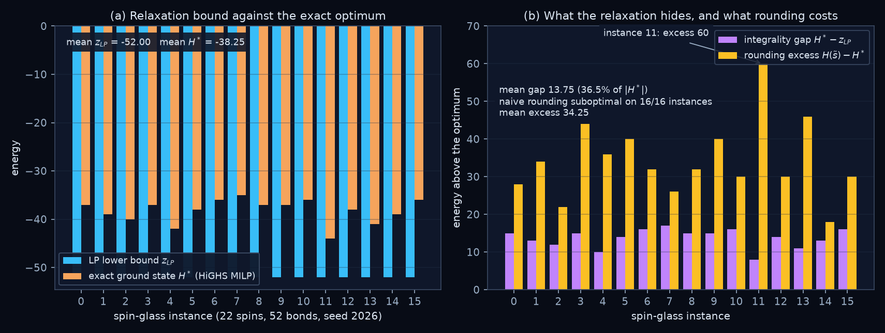 | 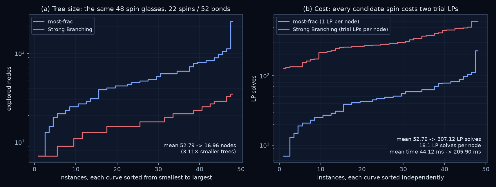 |

| A network that copies the strong rule for free | Laptop time and size transfer to 30 spins |
| :---: | :---: |
| 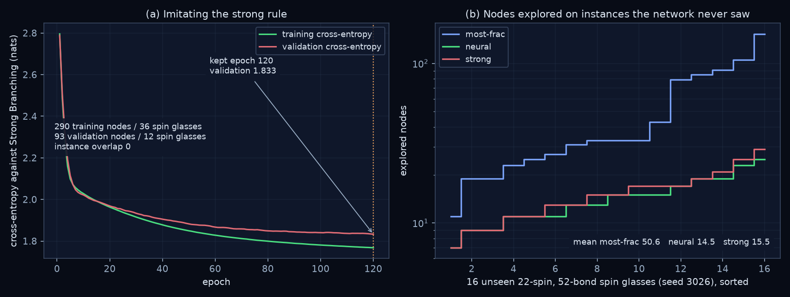 | 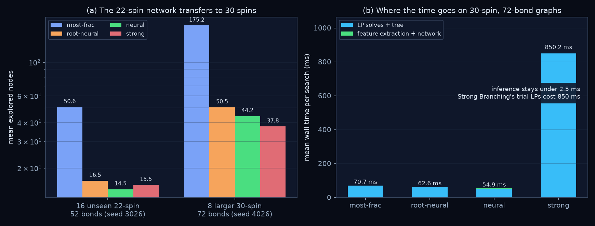 |

```bash
cd week12
cargo install --path . --force          # builds HiGHS from source (needs cmake and a C++ compiler)
python scripts/run_all.py               # every run of Parts 1-4 and the four figures
python -m pytest tests -q               # 69 verification tests
python scripts/check_acceptance.py      # 42 checks against the sheet's numbers
python scripts/check_negative_controls.py   # 7 deliberate defects must be caught
```

The guide lists the run settings, the peak-refinement tables and one command beside each figure.

---

## Week 11: Hard Problems, Reductions & Tensor-Network Sampling

The sheet's four builds: factoring 15 sent around a reduction with `pred` (Factoring → CircuitSAT → SpinGlass → 3 × 5), every logic gate turned into a small magnet whose floor is its truth table, a tropical (min-plus) contraction that returns the exact ground-state energy and degeneracy of a 104-spin magnet together with rescaled `log Z` and 2000 Boltzmann draws from one stored tree, and the N-queens puzzle encoded directly as a carry tensor network and sampled uniformly. One Rust tool, `tnsample`, planned by `omeco` 0.2.6; Python only for the independent references, the figures and the browser check.

- **Guide and reproduction commands:** [week11/README.md](week11/README.md)
- **Interactive Studio and 3 evidence figures:** [Week 11 Sampling Lab](https://imgrj.github.io/AMAT5315-2026Fall-Exercise/week11-tnsample-lab.html)
- **Verification:** 40 independent tests, 4 Rust checks, 52 acceptance checks and three recorded negative controls.

| Result | Measured evidence |
| :--- | :--- |
| Factoring round trip (`pred` 0.6.0) | 15 → **104 spins**, ground state `Min(-299)`, decoded `[1,1,1,0,1]` = **3 × 5**, `Min(0)`; 6 → 2 × 3 `Min(0)`; 7 → 3 × 2 = 6 `Min(1)` (no pair exists) |
| Gate gadgets | AND/OR floor **−3**, NOT/COPY/SET floor **−1**, XOR (with helper) **−4**; the joined AND-NOT-SET1 circuit reaches `E₀ = −5` on exactly **3 of 16** states |
| 10×10 ferromagnet, β = 2 | `E_min = −180 = −2L(L−1)`, `g₀ = 2`, `log Z = 360.694747` |
| factor_15 magnet, β = 2 | `E_min = −299`, `g₀ = 1`, `log Z = 598.317945`, `sc = 5` (**32** entries instead of 2¹⁰⁴ states) |
| 2000 Boltzmann draws | `p₀ = 0.727643`; predicted **1455.29 ± 19.91**, observed **1466**; `pred extract` decodes the ground state to 3 × 5 |
| Planning `k`-bit factors | spins **72…960**; `treesa sc = 4,7,9,11,13,15,17` (the 2k+1 seam), `tc = 10.62…24.08`; `greedy` runs to **55** |
| N-queens counts, N = 4…10 | **2, 10, 4, 40, 92, 352, 724**, every one matching OEIS A000170 |
| 200 uniform boards | all valid; 6-queens frequencies **52, 49, 47, 52** (χ² = 0.36); 8-queens visits **85** of 92 boards (expected 81.7) |

| Every logic rule on its floor | Memory grows, the ground state dominates |
| :---: | :---: |
| 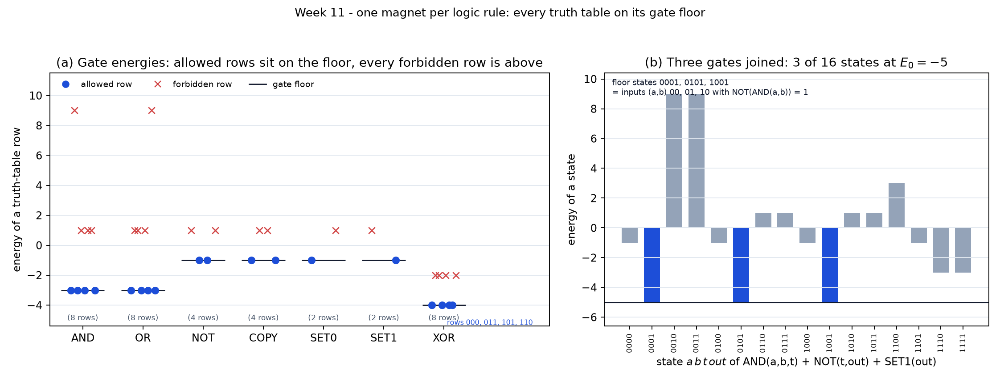 | 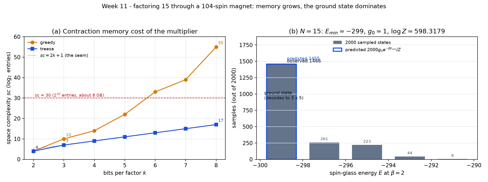 |

| A chess puzzle as a tensor network |
| :---: |
| 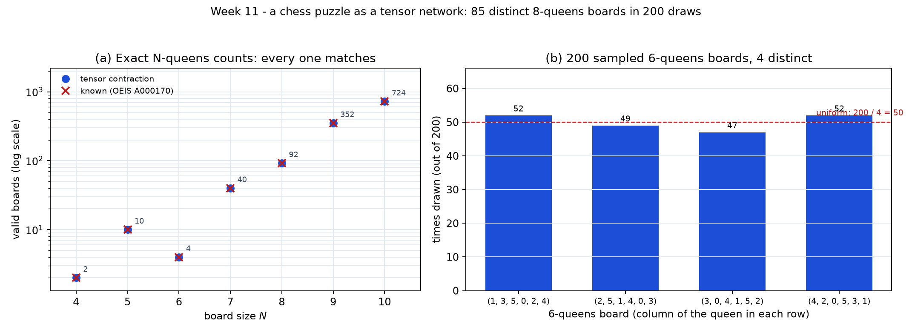 |

```bash
cd week11
cd tnsample && cargo install --path . --force && cd ..   # the tnsample tool
python scripts/run_pred.py               # Part 1: the pred round trip
python scripts/run_all.py                # every stated run and the three figures
python -m pytest -q                      # 40 verification tests
python scripts/check_sheet.py            # 52 checks against the sheet
python scripts/check_web.py              # 11 browser checks (needs Edge + Playwright)
```

The guide lists the run settings, the seeds, the scaling table and one command beside each figure.

---

## Week 10: Approximate Tensor Contraction for the Ising Model

The sheet's three builds: a truncated-SVD storage study of a seeded 512×512 Gaussian matrix, a boundary-MPS row contraction of open Ising squares up to 64×64, and tensor-renormalization-group coarse-graining of periodic squares up to 1024×1024. The specific-heat peaks of those contractions locate the Onsager transition without sampling a single spin configuration. One Rust tool, `thermo`, with its own Jacobi SVD, Krylov truncated SVD and `.npy` writer; Python only for figures, tests and the browser check.

- **Guide and reproduction commands:** [week10/README.md](week10/README.md)
- **Interactive Studio and 7 evidence figures:** [Week 10 Tensor RG Lab](https://imgrj.github.io/AMAT5315-2026Fall-Exercise/week10-tensor-lab.html)
- **Verification:** 41 independent tests, 46 acceptance checks and three recorded negative controls.

| Result | Measured evidence |
| :--- | :--- |
| Gaussian 512×512, seed 2026 | e₁₆ = 0.94229, e₂₅₆ = 0.32613, full rank exact to 1.3 × 10⁻¹³ |
| Measured error vs the discarded spectrum | worst gap **1.3 × 10⁻¹³**; 10% error only at χ = 395, 1.54× the storage |
| Open 4×4 at χ = 8 vs 2¹⁶ enumeration | |Δg| = **2.2 × 10⁻¹⁶**, c_V 0.439393 vs 0.439397 |
| Open peaks (L = 16 / 32 / 64) | **2.09310 / 2.17968 / 2.22422**; T_c = 2.26751 / 2.26877 (0.074% / 0.018%) |
| Periodic peaks (L = 64 / 256 / 1024) | **2.28160 / 2.27226 / 2.27001**; T_c = 2.26920 / 2.26926 (0.001% / 0.003%) |
| Peak stability | χ 16→32 and h halved move T_c by 0.001% (open) and 0.016% (periodic) |

| What a truncated SVD keeps | Open squares: where the peak sits |
| :---: | :---: |
| 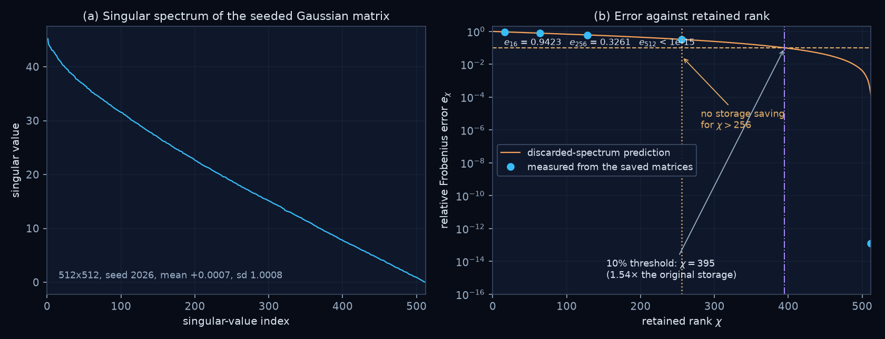 | 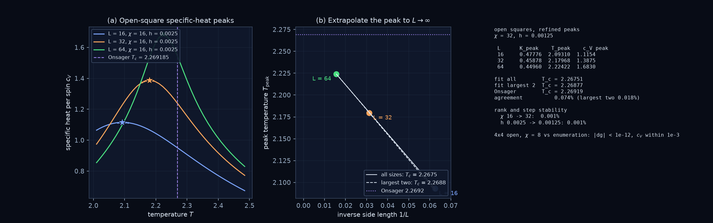 |

| Periodic squares: the same transition | Both geometries on one axis |
| :---: | :---: |
| 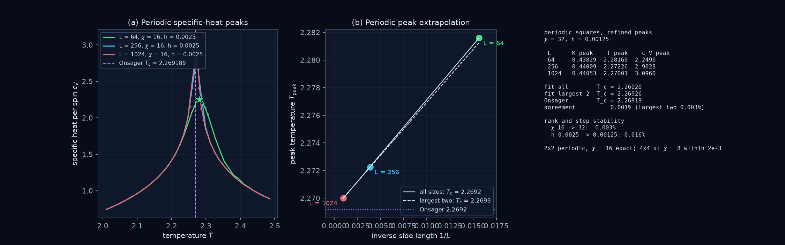 | 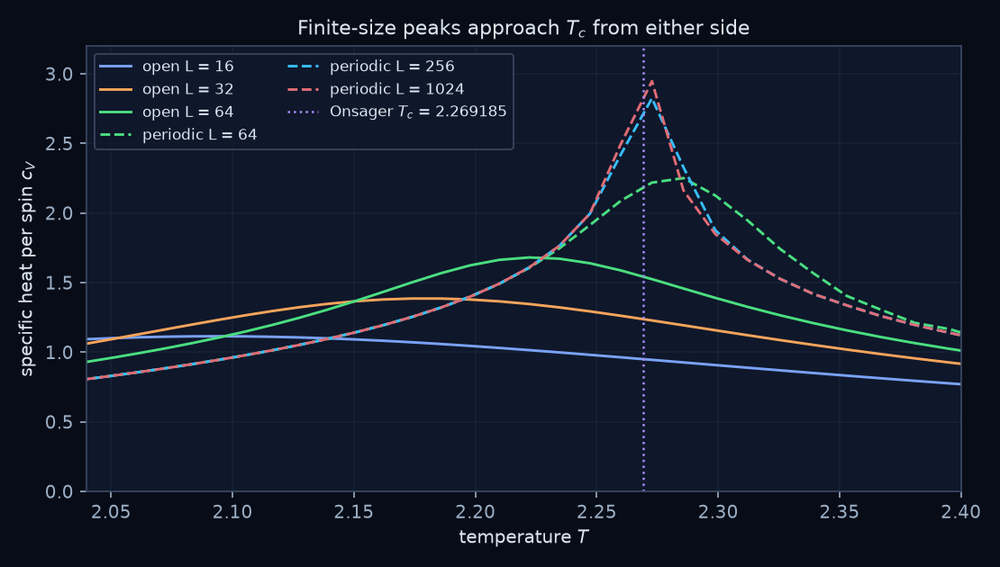 |

The guide lists the run settings, the peak-refinement table, the small-square checks and one command beside each figure.

---

## Week 9: Probabilistic Inference by Tensor Contraction

The learning sheet's four builds: exact ASIA inference by one tensor contraction, contraction orders and their cost, loopy belief propagation, and the 414-variable Promedus_14 UAI benchmark. Rust 1.96.0 with tenferro-rs for tensors and omeco for order search; Python only for plots and tests.

- **Guide and reproduction commands:** [week9/README.md](week9/README.md)
- **Interactive Studio and 9 evidence figures:** [Week 9 Inference Lab](https://imgrj.github.io/AMAT5315-2026Fall-Exercise/week9-inference-lab.html)
- **Verification:** 39 independent tests, 29 acceptance checks and a deliberate negative control.

| Result | Measured evidence |
| :--- | :--- |
| ASIA contraction vs 256-row enumeration | max marginal error 2.2 × 10⁻¹⁶; relative evidence error 1.3 × 10⁻¹⁵ |
| Evidence masses (prior / AD / ADX) | 1 / 0.004501375 / 0.00098822675 |
| Exhaustive pair-order work | **44 / 50 / 52** terms, matching the sheet |
| Loopy BP on ASIA (ADX) | 94 sweeps, residual 8.23 × 10⁻¹¹, marginal error **0.01061** |
| Promedus_14 exact | log₁₀ Z = **−7.80674630458244** (published −7.80675); MAR within 4.4 × 10⁻⁷ |
| Promedus_14 loopy BP | 1000 sweeps, **unconverged**, query error up to 0.3824 |

| Saved plans for one query | The joint keeps the dependence |
| :---: | :---: |
| 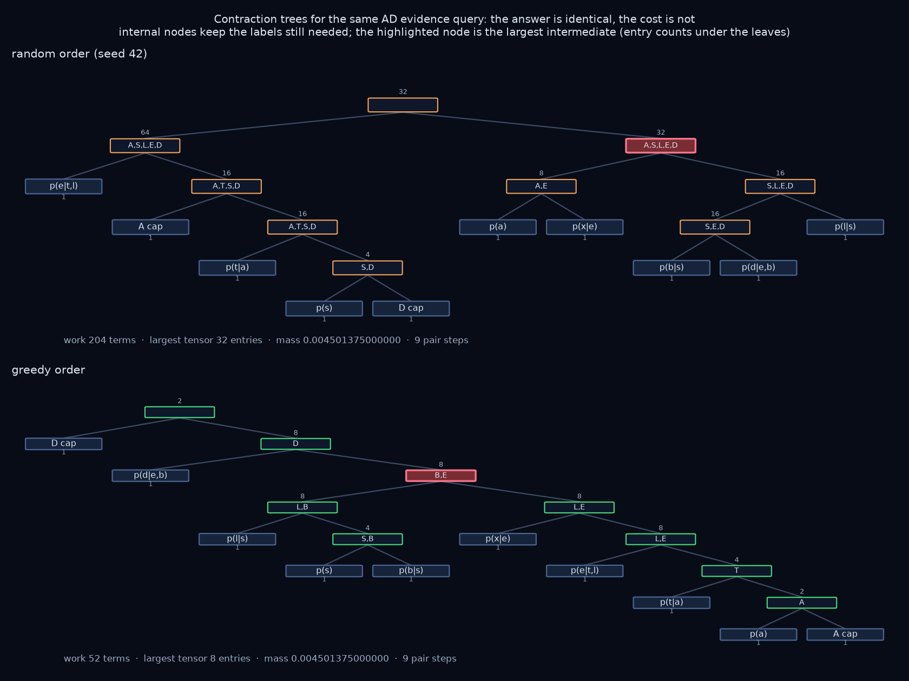 | 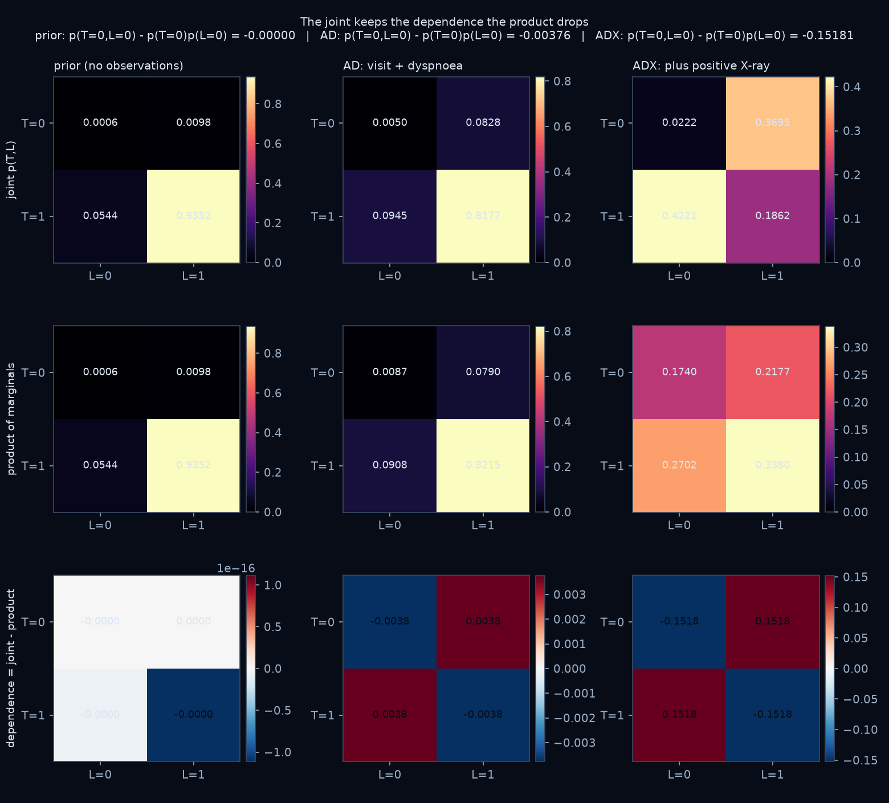 |

| Priors and posteriors | Converged loopy BP is not accurate |
| :---: | :---: |
| 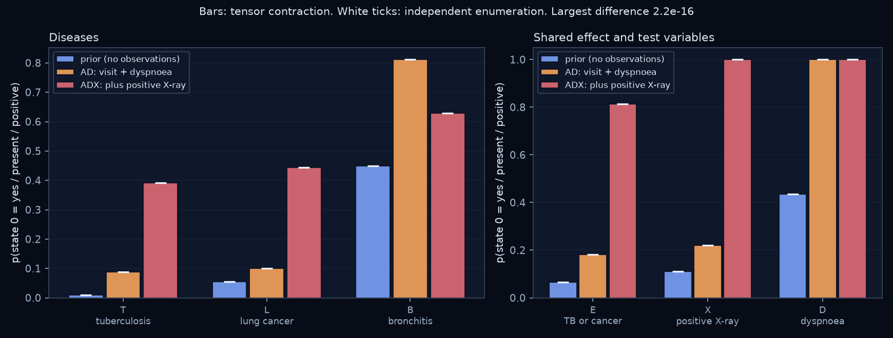 | 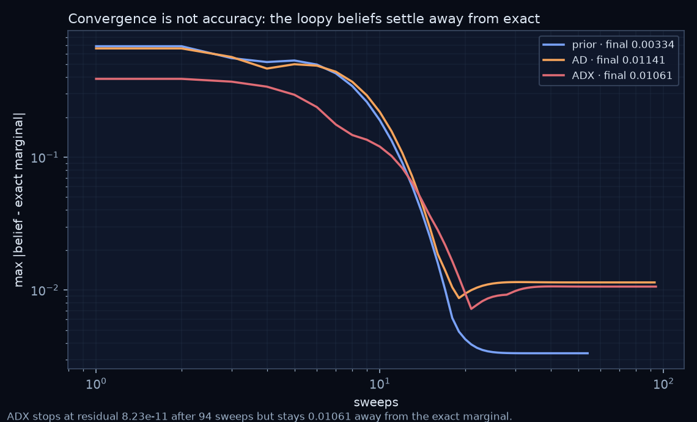 |

The guide lists the pinned data hashes and one command beside each figure.

---

## Week 8: Language Models and the Transformer

The complete six-part learning sheet: pretrained embedding geometry; TinyStories count models; linear and nonlinear memory capacity; softmax picture recall; a JAX transformer trained from scratch; and a bootstrap refit of Chinchilla scaling.

- **Guide and reproduction commands:** [week8/README.md](week8/README.md)
- **Interactive Studio and 14 evidence figures:** [Week 8 Language Lab](https://imgrj.github.io/AMAT5315-2026Fall-Exercise/week8-language-lab.html)
- **Verification:** 34 independent tests, 49 full-experiment acceptance checks and deliberate negative controls.

| Result | Measured evidence |
| :--- | :--- |
| Word relations become directions | Mean cosines 0.466 / 0.549 / 0.433; shuffled controls near zero |
| Count models reach a data limit | 4-gram 1.310 bits/character; 6-gram falls to 1.793 |
| MLP learns the bigram table | Loss difference +0.00495 nats/token |
| Attention recalls among 4,096 pictures | Softmax interference/signal 0.057 |
| Transformer beats all count models | **1.220 bits/character** after 6,000 CPU updates |
| Compute-optimal scaling | α=0.3473, β=0.3672; **17.9 tokens/parameter**, 95% interval 7.4–35.4 |

| Same validation stories, better predictions | Attention suppresses unrelated memories |
| :---: | :---: |
| 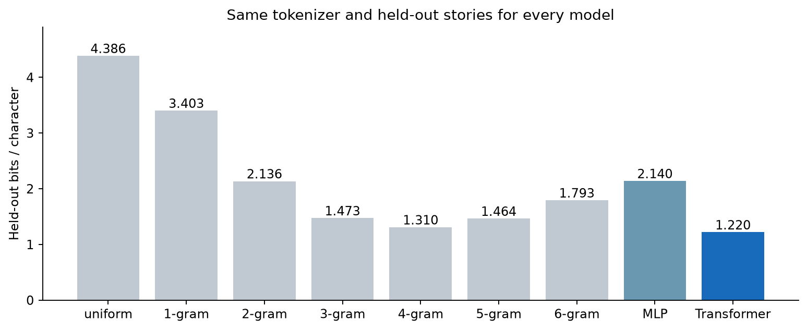 | 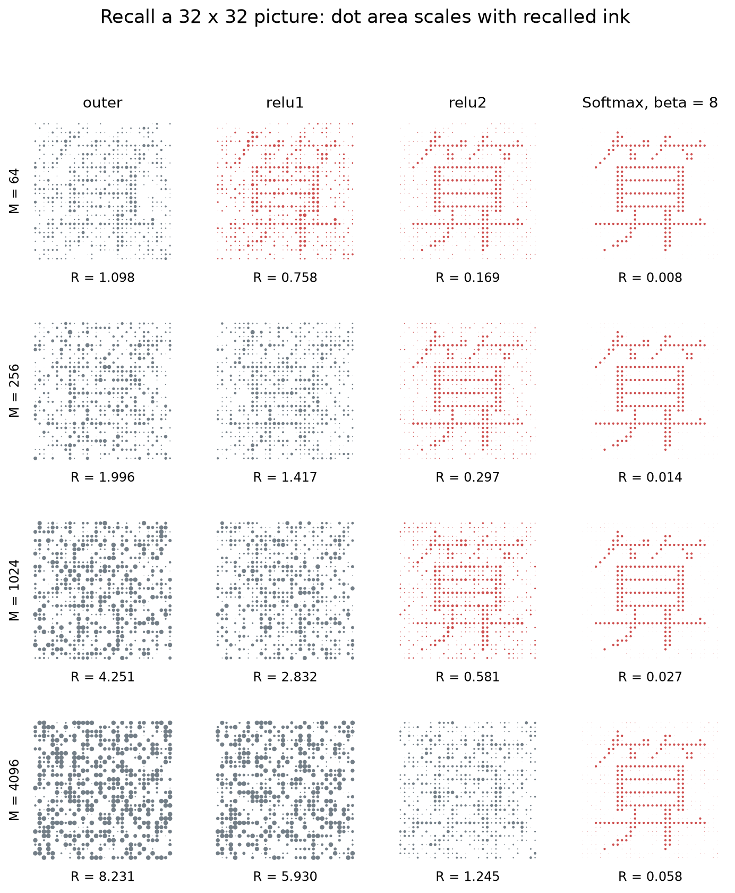 |

| Word relations as directions | Refit the compute-optimal allocation |
| :---: | :---: |
| 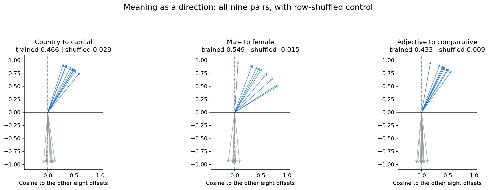 | 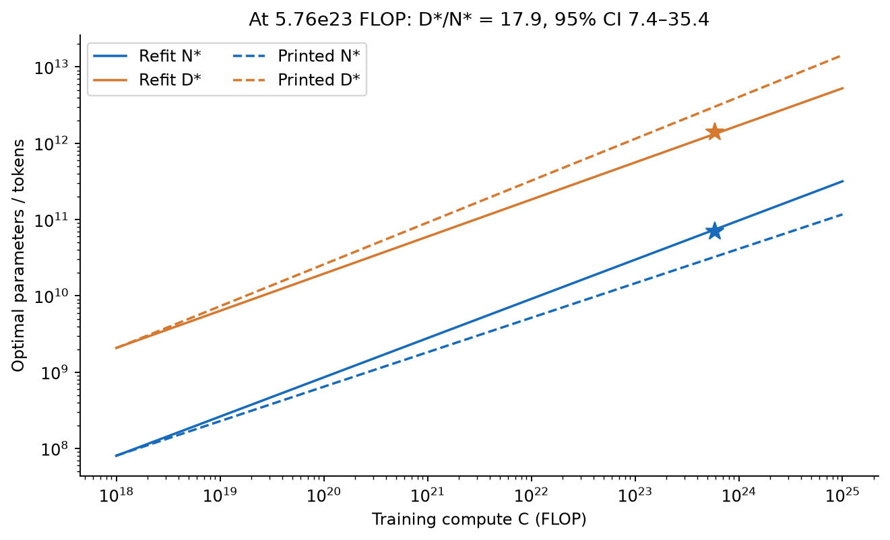 |

The guide lists pinned downloads and one command beside each figure. Raw data and model checkpoints stay out of Git.

---

## Week 7: Diffusion and Flow Matching

Generation by transporting fresh Gaussian noise, following the revised learning sheet's Algorithms 1-6: DDPM on a four-cluster mixture (Parts 1), deterministic DDIM (Part 2), flow matching and the sampling-cost comparison (Part 3), a JAX port of a pretrained CIFAR-10 noise predictor (Part 4), and RePaint inpainting (Part 5).

- **Full Documentation & Reproduction Guide**: [**`week7/README.md`**](week7/README.md)
- **Live Interactive Lab (runs the trained network in the browser)**: [**Week 7 Diffusion Lab**](https://imgrj.github.io/AMAT5315-2026Fall-Exercise/week7-diffusion-lab.html)
- **Configuration**: [`week7/diffusion.toml`](week7/diffusion.toml) and [`week7/flow.toml`](week7/flow.toml) pin the architecture, optimizer, seeds and checkpoint list.

### Key Results & Evidence Gallery

#### 1. DDPM on the Gaussian mixture (Algorithms 1-2)
- **Forward diffusion**: at `t = 1000` the per-coordinate mean is `(-0.0064, 0.0070)` and the variance `(0.977, 1.021)`, within the required 0.1 of the standard Gaussian.
- **Training**: 25,000 updates, batch 512, Adam with a cosine decay to zero, seed 2026; checkpoints at `0, 50, 100, 200, 500, 1000, 2000, 5000, 10000, 25000`. The loss plateaus at **0.2316**, near the reference 0.25, because the added noise is still uncertain given the noisy point (Eq. 14).
- **Generation** (2000 samples, 1000 steps): populations 0.2555/0.2675/0.2295/0.2475 (allowance 0.04), spreads 0.281-0.321 (allowance 0.03), largest centre error **0.040** (allowance 0.05). Denoiser control: 0.042/0.034/0.022 posterior standard deviations at `t = 100, 300, 600`, 0.243 at `t = 900`.

#### 2. Deterministic DDIM (Algorithm 3)
- Two DDIM runs over 1000 levels differ by **exactly 0**; two DDPM runs share their final cluster 23.5% of the time, the chance rate.
- DDIM populations 0.2450-0.2615 (within 0.015 of 0.25); widths at most **0.311**, with 0.310 for the same starts under exact conditional-mean noise and 0.307 for exact target draws, so the whole band `[0.29, 0.32]` holds.

#### 3. Flow matching and fewer steps (Algorithms 4-5)
- **Learned marginal velocity**: relative RMS error **0.020, 0.026, 0.066** at `s = 0.1, 0.5, 0.9` (requirement < 0.1).
- **Step-count sweep** (4000 samples per run, null 95% quantile 0.0038): flow matching reaches energy distance **0.0023 at 20 steps** (requirement < 0.005) with width error 0.019; DDIM reaches 0.0027 at 20 levels; DDPM is accurate from about twenty levels in this run and was the slowest in the reference. One or two steps collapse toward the mean for every sampler.

#### 4. The downloaded predictor on photographs
- **Port verification**: the JAX re-implementation of the diffusers v0.40.0 `UNet2DModel` matches the reference predictions to **7.15e-6** on six fixed inputs; 35,746,307 parameters (about 35.7M).
- **Generation**: four images from Gaussian noise with Algorithm 2 unchanged, unclipped; structure appears between `t = 200` and `t = 50`. Weights learned before the download; the reverse updates are computed here.

#### 5. RePaint inpainting (Algorithm 6)
- **Observed pixels**: hidden square rows/columns 6:26, 99 network evaluations per completion; the largest change of an observed pixel is **0.0** (requirement < 1e-5).
- **Hidden content**: mean hidden-pixel MSE **0.221** over 16 completions (reference 0.24), differing between seeds inside the hole; the variance map shows where the observation leaves the content undetermined.

| Trained DDPM recovers the four clusters | Flow matching and DDIM in tens of steps |
| :---: | :---: |
| 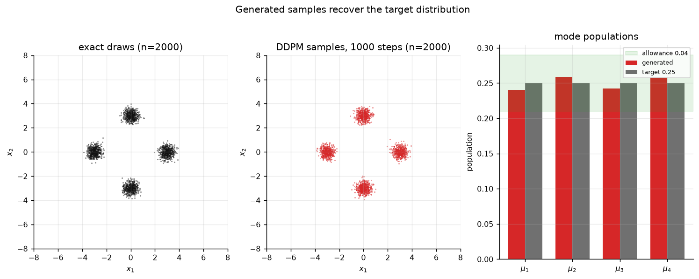 | 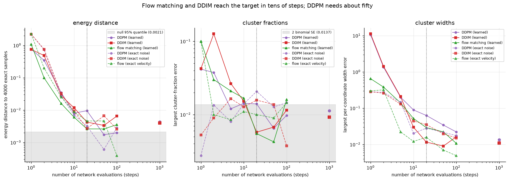 |

| Downloaded CIFAR-10 predictor | RePaint keeps every observed pixel |
| :---: | :---: |
| 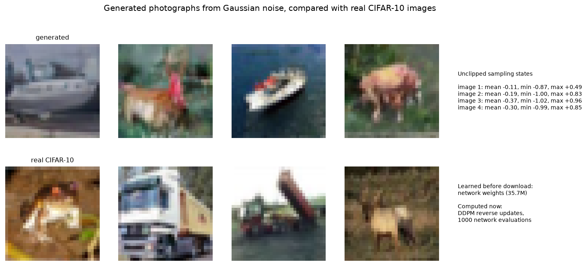 | 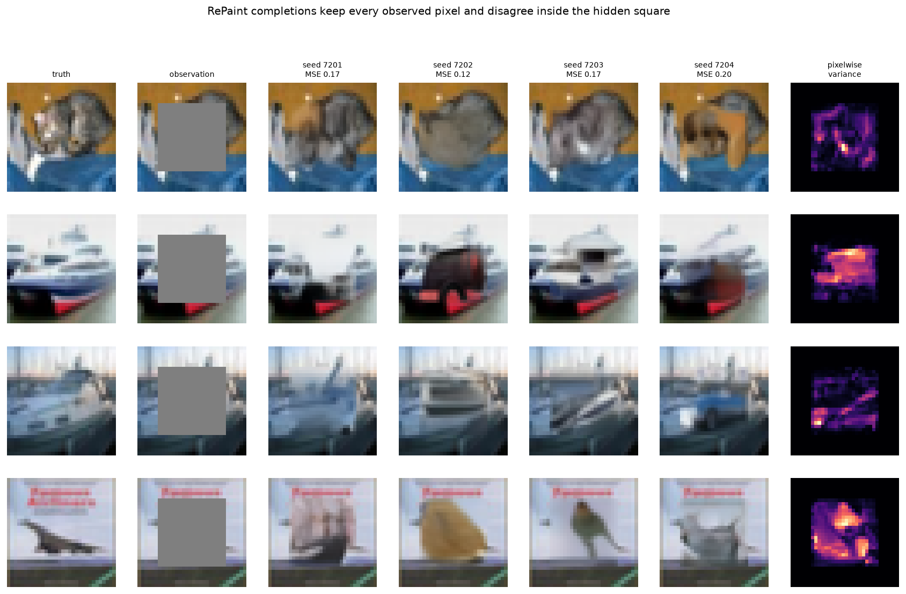 |

### Quick Reproducibility Commands

From `week7/` (CPU):
```powershell
python scripts/part1_forward.py        # Part 1 first task: target + forward diffusion only
python scripts/part1_diffusion.py      # Algorithms 1-2: training, DDPM, figures (~4 min)
python scripts/part2_ddim.py           # Algorithm 3 (~1 min)
python scripts/part3_flow.py           # Algorithms 4-5 and the step sweep (~6 min)
python scripts/part4_cifar.py          # pretrained CIFAR-10 DDPM, four images (~13 min)
python scripts/part5_inpaint.py        # Algorithm 6 (~4.5 min)
python -m pytest tests -q              # 35 verification tests
```

---

## Week 6: Energy-Based Models

Comprehensive implementation, verification, and empirical study of energy-based probabilistic generative models and associative memories:

- **Full Documentation & Reproduction Guide**: [**`week6/README.md`**](week6/README.md)
- **Live Interactive Simulator & Evidence Lightbox**: [**Week 6 Interactive Web Lab**](https://imgrj.github.io/AMAT5315-2026Fall-Exercise/week6-energy-lab.html)

### Key Results & Evidence Gallery

#### 1. Datasets & Native Pixels
- **MNIST**: $28 \times 28$ grayscale pixels ($60k$ train, $10k$ test). Digit `1` is most frequent ($11.24\%$), digit `5` least frequent ($9.03\%$).
- **CIFAR-10**: $32 \times 32$ RGB images ($50k$ train, $10k$ test). Exactly $5,000$ train and $1,000$ test images per class (balanced $0.1000$ fraction).

| MNIST Native Pixels & Class Frequencies | CIFAR-10 Native Pixels & Balanced Splits |
| :---: | :---: |
| 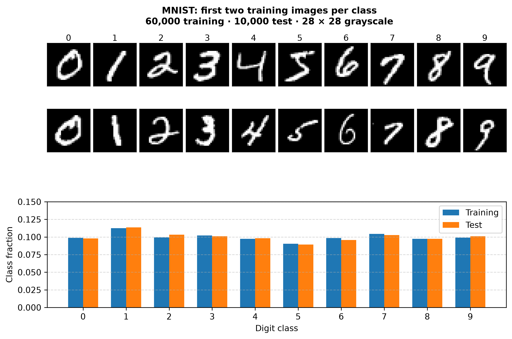 | 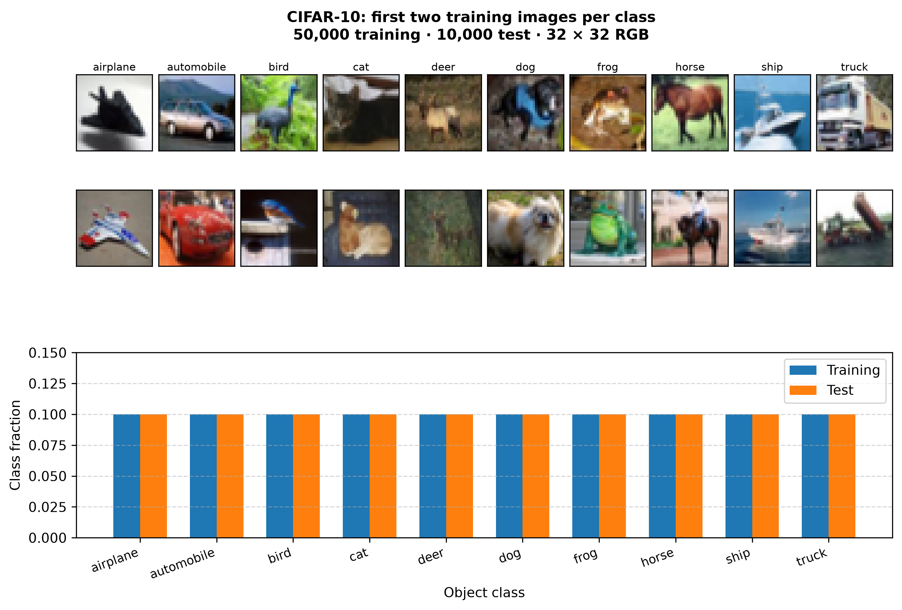 |

#### 2. Restricted Boltzmann Machine (RBM)
- **Visible Spins**: Pixels binarized at half intensity ($v_i \in \{0, 1\} \implies s_i = 2v_i - 1 \in \{-1, +1\}$).
- **CD-1 vs CD-10 Training**: Trained with automatic differentiation of free-energy differences and `stop_gradient` on 128 hidden units across 20 epochs.
  - Held-out one-step reconstruction error dropped from $49.96\%$ to **$4.77\%$** (CD-1) and **$4.95\%$** (CD-10).
- **Generation from Random Spins**: Pure noise evolves through Gibbs sweeps into connected strokes and coherent digit contours.
- **Clamped Image Completion**: Upper half clamped, lower half sampled; ink overlap $2|A \cap B|/(|A|+|B|)$ on 64 test digits exceeds wrong-upper-half conditioning by **$+0.167$** (CD-1) and **$+0.202$** (CD-10), far exceeding the required $0.10$ margin.

| RBM Training Learning Curves | Fresh Generation from Random Spins |
| :---: | :---: |
| 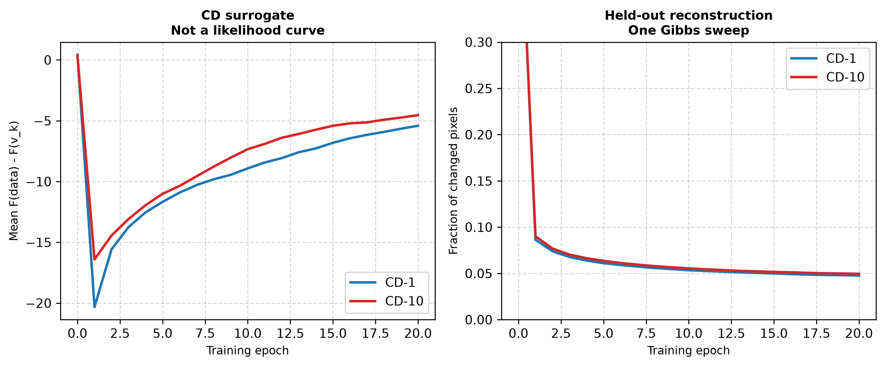 | 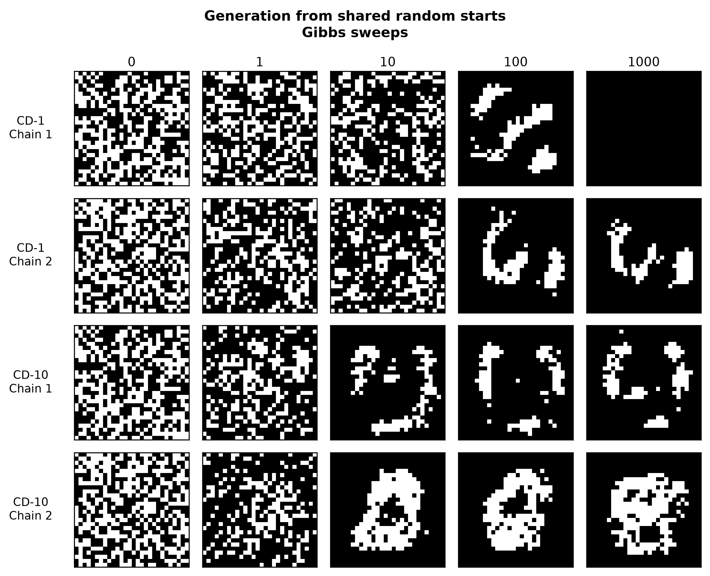 |

| Clamped Gibbs Image Completion | Quantitative Ink Overlap vs Sweeps |
| :---: | :---: |
| 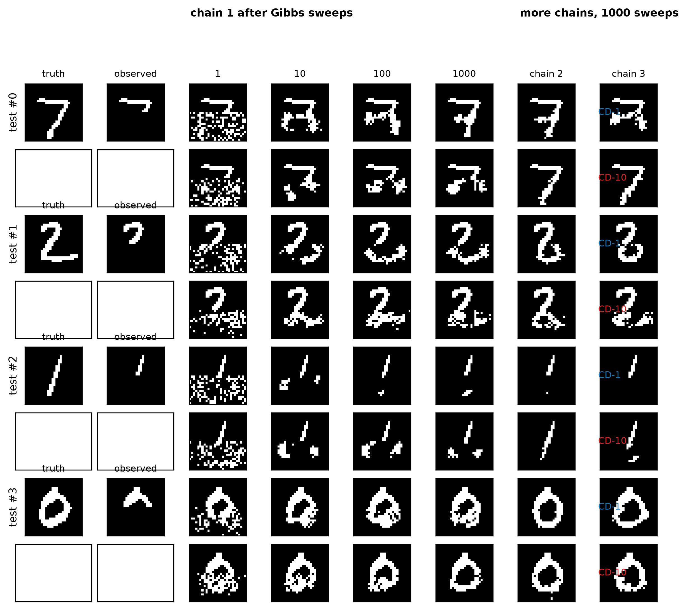 | 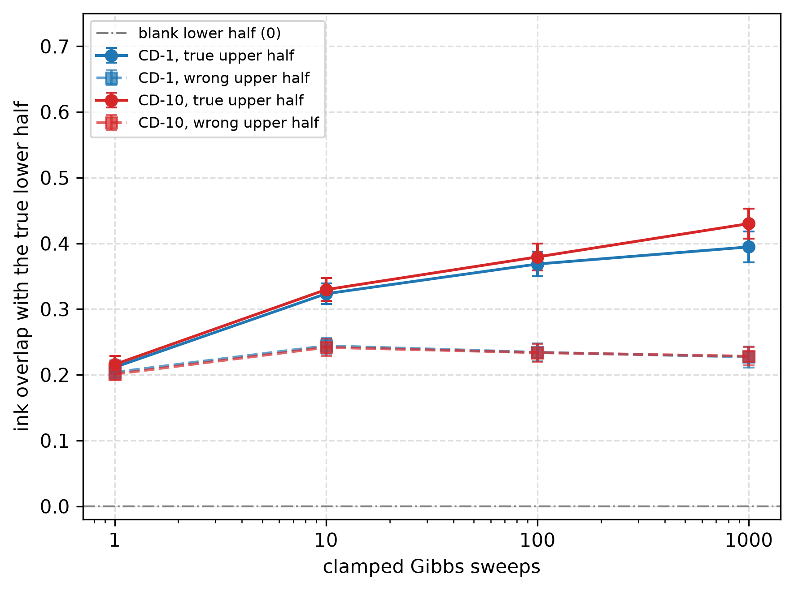 |

#### 3. Classical Hopfield Network & Capacity Collapse
- **Hebbian Couplings & Crosstalk**: Stored $P$ random patterns with $J_{ij} = \frac{1}{N}\sum_\mu \xi_i^\mu \xi_j^\mu$ ($J_{ii}=0$).
  - Unstable bit fraction follows Gaussian crosstalk prediction $\Phi(-1/\sqrt{\alpha})$ with finite-$N$ correction $\Phi(-\sqrt{\frac{N-1}{P-1}})$.
- **Storage Capacity Phase Transition**: Zero-temperature asynchronous recall sweeps demonstrate storage capacity collapse toward Amit-Gutfreund-Sompolinsky limit $\alpha_c \approx 0.138$.
  - Crossing points ($m < 0.90$): $N=100 \implies 0.175$, $N=200 \implies 0.166$, $N=400 \implies 0.154$, $N=800 \implies 0.146$ (all within $0.011$ of reference).

| Hopfield Unstable Bits vs Crosstalk | Storage Capacity & Recall Collapse |
| :---: | :---: |
| 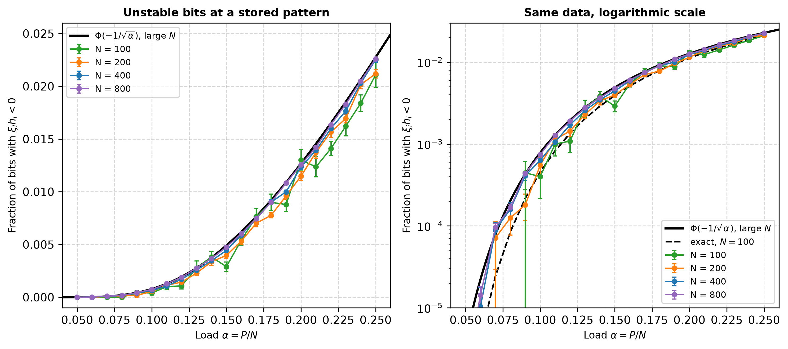 | 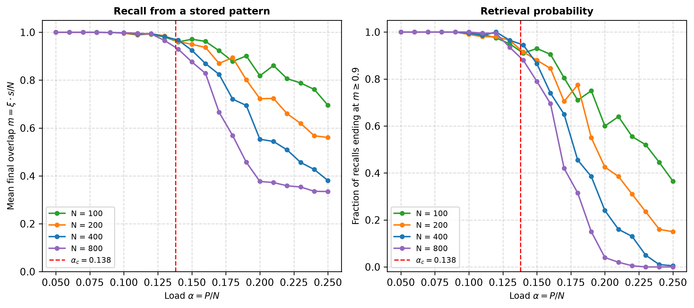 |

#### 4. Modern Hopfield Network & Softmax Attention Equivalence
- **Exact Transformer Attention Identity**: The modern update $x \leftarrow X \mathrm{softmax}(\beta X^T x)$ mathematically matches scaled dot-product attention:
  $$\mathrm{Attention}(q, K, V) = V^T \mathrm{softmax}(\beta K q)$$
  Measured maximum absolute difference with `jax.nn.dot_product_attention` is **$1.31 \times 10^{-6}$** ($< 10^{-5}$).
- **Temperature-Controlled Retrieval**:
  - $\beta \le 0.01$: diffuse average of all stored digits.
  - $\beta = 0.03$: target digit features emerge from background.
  - $\beta \ge 0.1$: sharp single-step memory retrieval.
- **Correlated Digit Capacity**:
  - Classical Hebbian recall achieves **$0.0\%$** success for all $P \in \{3, 10, 30, 100, 300, 1000\}$ due to high background correlations ($87\%$ background pixels).
  - Modern Hopfield ($\beta = 0.3$) achieves **$95\% \sim 100\%$** retrieval success across all $P$ up to $1000$.

| Softmax Weights across Temperature $\beta$ | Retrieval Transition Gallery across $\beta$ |
| :---: | :---: |
| 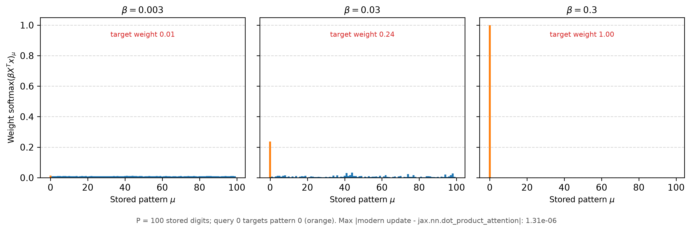 | 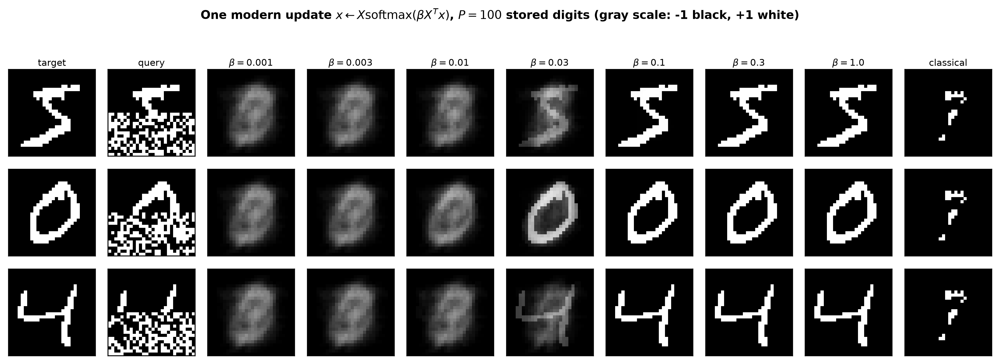 |

| Capacity: Modern vs Classical on Digits | Modern Hopfield Retrieval Gallery ($P=100$) |
| :---: | :---: |
| 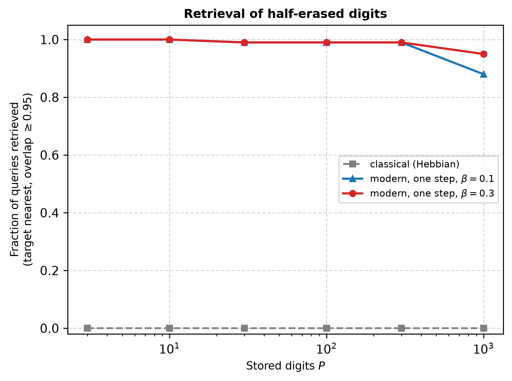 | 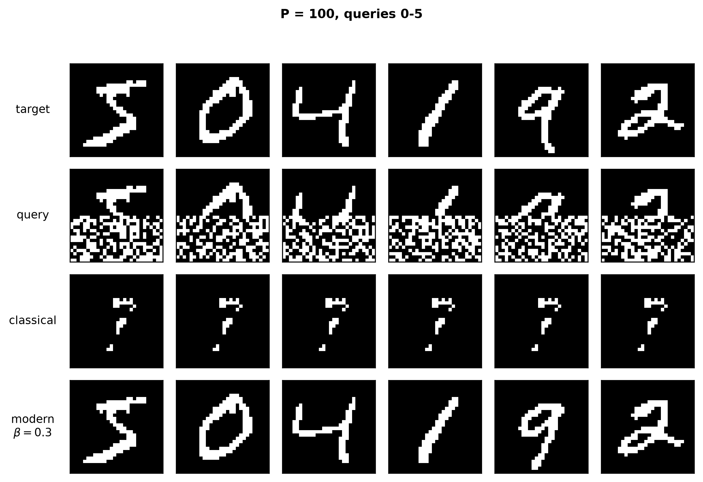 |

### Quick Reproducibility Commands

From `week6/`:
```bash
# Part 1: Datasets inspection
python scripts/part1_datasets.py

# Part 2: RBM CD-1 / CD-10 training, generation & completion
python scripts/part2_rbm.py

# Part 3: Classical Hopfield crosstalk & capacity sweeps
python scripts/part3_hopfield.py

# Part 4: Modern Hopfield attention equivalence & correlated digit benchmark
python scripts/part4_modern_hopfield.py
```

---

## Week 1: AI Agents & Monte Carlo $\pi$ Estimator

Week 1 contains `pi.py`, a Monte Carlo estimator of $\pi$ using pseudo-random dart throws in the unit square, along with `test_pi.py`.

```bash
python3 -m pytest week1/
```

Expected output:
```
estimate=3.146604, absolute error=0.005011
```

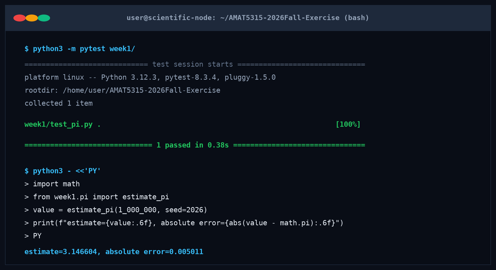
