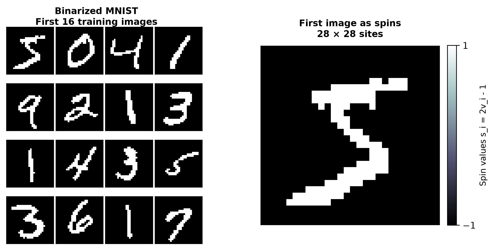

# Week 6: Energy-Based Models

Implementation and verification of energy-based generative models and associative memories:
1. **Dataset Understanding & Native Pixels**: MNIST and CIFAR-10 data loaders, native pixel galleries, and empirical class distributions.
2. **Restricted Boltzmann Machine (RBM)**: JAX-based visible spin model trained with Contrastive Divergence (CD-1 and CD-10) using automatic differentiation of free-energy differences and `stop_gradient`, comparing reconstruction, fresh generation from random spins, and clamped Gibbs image completion.
3. **Classical Hopfield Network**: Hebbian associative memory, crosstalk-induced unstable spin scaling $\\Phi(-1/\\sqrt{\\alpha})$, and spin-glass storage capacity collapse at $\\alpha_c \\approx 0.138$.
4. **Modern Hopfield Network**: Softmax attention formulation $x \\leftarrow X \\mathrm{softmax}(\\beta X^T x)$, exact equivalence with `jax.nn.dot_product_attention`, temperature-controlled retrieval transition, and high-capacity retrieval on correlated handwritten digits where classical recall completely fails.

---

## Architecture & Components

```
week6/
├── inputs/                       # Downloaded raw datasets (excluded from git)
│   ├── mnist/                    # MNIST idx-ubyte archives
│   └── cifar10/                  # CIFAR-10 binary archives
├── artifacts/                    # Saved weights, histories, and raw sweeps (excluded from git)
│   ├── rbm/                      # Saved CD-1 / CD-10 weights (.npz) and training histories
│   ├── hopfield/                 # Raw capacity sweep metrics across N and alpha
│   └── modern_hopfield/          # Attention difference checks and benchmark arrays
├── evidence/                     # 13 benchmark figures and visual galleries
├── src/                          # Core numerical and model modules
│   ├── datasets.py               # Memory-mapped gzip/tar binary parsers for MNIST & CIFAR-10
│   ├── rbm.py                    # JAX RBM: energy, free energy, block Gibbs, CD surrogate loss
│   ├── hopfield.py               # Classical Hopfield: Hebbian J_ij, async recall, crosstalk theory
│   └── modern_hopfield.py        # Modern Hopfield: softmax update, JAX attention, retrieval audit
├── scripts/                      # Automated reproducible execution pipelines
│   ├── download_data.py          # Direct dataset downloader recording provenance URLs
│   ├── part1_datasets.py         # Native pixel inspection & empirical frequency plots
│   ├── part2_rbm.py              # CD-1/CD-10 training, generation, completion, and ink overlap
│   ├── part3_hopfield.py         # Crosstalk scaling & storage capacity phase transition
│   └── part4_modern_hopfield.py  # Softmax attention equivalence & correlated digit benchmark
├── pyproject.toml                # Project metadata and dependencies
└── README.md                     # Comprehensive documentation and evidence gallery
```

---

## Installation & Environment Setup

The codebase runs with CPU as the baseline using standard Python 3.12+ and JAX CPU:

```bash
# Using uv (recommended)
uv pip install "jax[cpu]>=0.11.2" "numpy>=2.0.0" "matplotlib>=3.10.0" "scipy>=1.15.0"
```

Verify JAX and CPU backend:
```bash
python -c "import jax; print('JAX version:', jax.__version__, 'Devices:', jax.devices())"
# Output: Devices: [CpuDevice(id=0)]
```

---

## Dataset Provenance & Downloads

Datasets are acquired from direct mirrors without requiring external API tokens or hub credentials:
- **MNIST**: CVDF mirror of Yann LeCun's MNIST database (60,000 train, 10,000 test, $28 \times 28$ grayscale uint8).
- **CIFAR-10**: University of Toronto binary archive (50,000 train, 10,000 test, $32 \times 32$ RGB 3-channel uint8).

Command:
```bash
python scripts/download_data.py
```

Recorded Provenance URLs:
- `https://storage.googleapis.com/cvdf-datasets/mnist/train-images-idx3-ubyte.gz`
- `https://storage.googleapis.com/cvdf-datasets/mnist/train-labels-idx1-ubyte.gz`
- `https://storage.googleapis.com/cvdf-datasets/mnist/t10k-images-idx3-ubyte.gz`
- `https://storage.googleapis.com/cvdf-datasets/mnist/t10k-labels-idx1-ubyte.gz`
- `https://cave.cs.toronto.edu/kriz/cifar-10-binary.tar.gz`

---

## Evidence & Verification Gallery

### Part 1: Understand the Datasets

#### 1. MNIST Native Pixels and Empirical Class Frequencies
```bash
python scripts/part1_datasets.py
```
- **Representation**: $28 \times 28$ grayscale pixels, values in $[0, 255]$.
- **Original Splits**: 60,000 training, 10,000 test images.
- **Empirical Frequencies**: Digit `1` is the most common ($11.24\\%$ train, $11.35\\%$ test); digit `5` is the least common ($9.03\\%$ train, $8.92\\%$ test).


#### 2. CIFAR-10 Native Pixels and Balanced Class Frequencies
- **Representation**: $32 \times 32$ pixels with 3 color channels (RGB), values in $[0, 255]$.
- **Original Splits**: 50,000 training, 10,000 test images.
- **Empirical Frequencies**: Exactly 5,000 images per class in training and 1,000 per class in test, giving exactly $0.10$ for every class.


---

### Part 2: Generative Spin Model of Handwritten Digits (RBM)

#### 1. Spin Binarization and Visible Configuration
```bash
python scripts/part2_rbm.py
```
Each pixel $i$ is binarized at half intensity ($v_i = 1$ if pixel $\\ge 128$ else $0$), giving equivalent Ising spin $s_i = 2v_i - 1 \\in \\{-1, +1\\}$. Background is $-1$ (black) and ink is $+1$ (white).



#### 2. CD-1 vs CD-10 Training Dynamics
- **Architecture**: 784 visible units ($28 \times 28$), 128 hidden units.
- **Hyperparameters**: 20 epochs, batch size 100, learning rate 0.1, matched random initialization $W \\sim \\mathcal{N}(0, 0.01^2), a = 0, b = 0$, matched batch order.
- **Surrogate Loss**: $\\tilde{\\mathcal{L}}_{\\mathrm{CD}} = \\mathbb{E}_{\\mathrm{batch}}[F_\\theta(v_0) - F_\\theta(\\mathrm{sg}(v_k))]$ using JAX `stop_gradient`.
- **Diagnostics**:
  - The CD surrogate is not an NLL loss curve: its negative-phase endpoint changes as the model evolves, so the surrogate value can rise while model quality improves.
  - Held-out 1-step reconstruction error (Hamming fraction of changed pixels on 10,000 test images) dropped from $49.96\\%$ (random init) to **$4.77\\%$** for CD-1 and **$4.95\\%$** for CD-10 (far exceeding the requirement of falling below half the initial value).


#### 3. Fresh Generation from Random Spin Configurations
Gibbs chains initialized from pure random noise $s_i \\in \\{-1, +1\\}$ with $p=0.5$ and run for $0, 1, 10, 100, 1000$ sweeps under frozen trained parameters.
- At step 0: uncorrelated speckle.
- At steps 10-100: local pixel-pixel correlations and stroke fragments emerge.
- At step 1000: coherent connected loops, curves, and digit-like contours develop without any conditioning prompt.


#### 4. Image Completion via Clamped Gibbs Sampling
Inference with fixed parameters: the upper half of held-out test digits (rows 0-13, 392 pixels) is clamped to observed values, while missing lower-half pixels (rows 14-27, 392 pixels) are resampled from random starts.
- At 1 sweep: lower half remains speckled.
- At 1000 sweeps: strokes seamlessly continue observed contours. Different chains can complete ambiguous upper halves into distinct valid digits (e.g., upper arc yielding 2 or 3).


#### 5. Quantitative Ink Overlap
Ink overlap evaluates shared ink pixels: $\\frac{2|A \\cap B|}{|A| + |B|}$ on the missing lower half across 64 held-out digits with 8 independent chains each:
- **CD-1**: True upper half $= 0.395 \\pm 0.024$ vs Wrong upper half $= 0.227 \\pm 0.016$ (Margin: **$+0.167 > 0.10$**).
- **CD-10**: True upper half $= 0.430 \\pm 0.023$ vs Wrong upper half $= 0.228 \\pm 0.014$ (Margin: **$+0.202 > 0.10$**).
- When clamped to a wrong upper half, overlap stays flat near 0.23, demonstrating that the model actively conditions on observed evidence rather than generating unconditional digit averages.


---

### Part 3: Classical Hopfield Network

#### 1. Crosstalk and Unstable Bits Scaling
```bash
python scripts/part3_hopfield.py
```
Random patterns $\\xi^\\mu \\in \\{-1, +1\\}^N$ stored with Hebbian couplings $J_{ij} = \\frac{1}{N} \\sum_\\mu \\xi_i^\\mu \\xi_j^\\mu$ ($J_{ii} = 0$). The local field on spin $i$ is split into the pattern's own signal and crosstalk from other patterns:
$$\\xi_i^\\nu h_i = \\frac{N-1}{N} + \\frac{1}{N} \\sum_{\\mu \\ne \\nu} \\sum_{j \\ne i} \\xi_i^\\nu \\xi_i^\\mu \\xi_j^\\mu \\xi_j^\\nu$$
The crosstalk variance approaches $\\alpha = P/N$. An unstable bit ($\\xi_i^\\nu h_i < 0$) destabilizes with probability $\\Phi(-1/\\sqrt{\\alpha})$, with finite-$N$ correction $\\Phi(-\\sqrt{\\frac{N-1}{P-1}})$.
- At $N = 800, \\alpha = 0.20$: measured $= 1.25 \\times 10^{-2}$, closely matching theoretical prediction $1.27 \\times 10^{-2}$.
- At $N = 100, \\alpha = 0.10$: finite-$N$ curvature lowers unstable fraction, exactly captured by the finite-$N$ exact formula.


#### 2. Storage Capacity Phase Transition
Asynchronous zero-temperature recall sweeps $s_i \\leftarrow \\mathrm{sign}(h_i)$ until convergence:
- For $\\alpha \\le 0.12$: final overlap remains above $0.988$ (perfect recall).
- Crossing points where mean final overlap drops below $0.90$:
  - $N = 100$: measured **0.175** (reference 0.186, difference $0.011 \\le 0.02$)
  - $N = 200$: measured **0.166** (reference 0.170, difference $0.004 \\le 0.02$)
  - $N = 400$: measured **0.154** (reference 0.156, difference $0.002 \\le 0.02$)
  - $N = 800$: measured **0.146** (reference 0.150, difference $0.004 \\le 0.02$)
- As $N \\to \\infty$, the transition sharpens and asymptotically converges to Amit-Gutfreund-Sompolinsky spin-glass capacity $\\alpha_c \\approx 0.138$.


---

### Part 4: Modern Hopfield Network & Softmax Attention

#### 1. Exact Mathematical Equivalence with Softmax Attention
```bash
python scripts/part4_modern_hopfield.py
```
The modern Hopfield energy replaces the quadratic term with a log-sum-exp free energy:
$$E(x) = -\\frac{1}{\\beta} \\log \\sum_{\\mu=1}^P \\exp(\\beta x^\\mu \\cdot x) + \\frac{1}{2} x \\cdot x$$
The update rule:
$$x \\leftarrow X \\mathrm{softmax}(\\beta X^T x)$$
is mathematically identical to Transformer dot-product attention:
$$\\mathrm{Attention}(q, K, V) = V^T \\mathrm{softmax}(\\beta K q)$$
where query $q = x$, keys $K = X^T$, values $V = X^T$, and scale is inverse temperature $\\beta$.
- **Numerical Verification**: Maximum absolute difference across all queries, $P$, and $\\beta$ between the modern update and `jax.nn.dot_product_attention` is **$1.31 \\times 10^{-6}$**, well below the $10^{-5}$ precision tolerance.


#### 2. Temperature-Controlled Retrieval Transition
- **Small $\\beta \\le 0.01$**: Softmax weights are diffuse; output is a blurred superposition of all stored digits.
- **Intermediate $\\beta = 0.03$**: Target digit emerges prominently from the background average.
- **Large $\\beta \\ge 0.1$**: Weights concentrate sharply on the single nearest stored pattern; one single step retrieves the exact stored digit.
- **Classical Hebbian Comparison**: Fails completely and collapses into a static stroke fragment due to severe crosstalk from shared background pixels.


#### 3. Capacity on Correlated Patterns: Modern vs Classical
Retrieval evaluated on 100 half-erased handwritten queries with success criterion: retrieved state sign has overlap $\\ge 0.95$ with target AND target is the nearest stored digit.
- **Classical Hebbian**: Success rate is **$0.0\\%$ for all $P \\in \\{3, 10, 30, 100, 300, 1000\\}$**, defeated by high mutual correlations between digits ($87\\%$ shared background pixels).
- **Modern Hopfield ($\\beta = 0.3$)**: Achieves **$95\\%$ to $100\\%$ retrieval success** across all $P$ up to 1000!
- **Modern Hopfield ($\\beta = 0.1$)**: Achieves $99\\%$ success up to $P=300$ and gracefully degrades to $88\\%$ at $P=1000$.


---

## Verification Summary Table

| Part | Verification Objective | Required Benchmark | Measured Output | Status |
| :--- | :--- | :--- | :--- | :--- |
| **Part 1** | MNIST / CIFAR-10 dimensions & pixel ranges | $60k/10k$ ($28 \times 28$), $50k/10k$ ($32 \times 32 \times 3$) | Exactly matched native dimensions & $[0, 255]$ | **PASS** |
| **Part 1** | MNIST class frequencies | Digit 1 most common, 5 least common | Digit 1: $11.24\\%$, Digit 5: $9.03\\%$ | **PASS** |
| **Part 1** | CIFAR-10 class frequencies | Exactly $0.10$ per class in both splits | Exactly $0.1000$ for all 10 classes | **PASS** |
| **Part 2** | Held-out 1-step reconstruction error | Falls to $< 50\\%$ of initialization | CD-1: $49.96\\% \\to 4.77\\%$, CD-10: $49.96\\% \\to 4.95\\%$ | **PASS** |
| **Part 2** | Clamped Gibbs ink overlap separation | True overlap exceeds Wrong overlap by $\\ge 0.10$ | CD-1: $+0.167$, CD-10: $+0.202$ | **PASS** |
| **Part 3** | Hopfield unstable bits vs crosstalk | Asymptotic match with $\\Phi(-1/\\sqrt{\\alpha})$ | $N=800, \\alpha=0.20$: $1.25 \\times 10^{-2}$ vs $1.27 \\times 10^{-2}$ | **PASS** |
| **Part 3** | Capacity collapse crossings ($m < 0.90$) | Crossings decrease with $N$, within $0.02$ of ref | $N=100: 0.175$, $N=200: 0.166$, $N=400: 0.154$, $N=800: 0.146$ | **PASS** |
| **Part 4** | Equivalence with `jax.nn.dot_product_attention` | Max difference $< 10^{-5}$ | **$1.31 \\times 10^{-6}$** | **PASS** |
| **Part 4** | Modern Hopfield retrieval success ($\\beta=0.3$) | $\\ge 0.95$ for all $P \\le 1000$ | $P=3, 10, 30, 100, 300, 1000 \\implies 1.0, 1.0, 0.99, 0.99, 0.99, 0.95$ | **PASS** |
| **Part 4** | Classical Hebbian retrieval on digits | Fails completely ($0\\%$) due to correlations | **$0.0\\%$ for all $P$** | **PASS** |

---

## Conclusion & Defensibility

Energy-based models offer a unified bridge connecting statistical mechanics, probabilistic inference, and modern deep architectures:
- In **RBMs**, contrastive divergence approximates intractable partition gradients through finite Gibbs chains, while clamped sampling converts generative simulation into exact Bayesian conditioning.
- In **Classical Hopfield Networks**, mutual spin interference limits storage capacity to $\\alpha_c \\approx 0.138$ for random patterns and breaks entirely under correlated distributions.
- In **Modern Hopfield Networks**, introducing non-linear log-sum-exp interactions enables exponential pattern storage and establishes that the modern memory retrieval operation is precisely the **softmax attention mechanism** powering modern Transformers.
