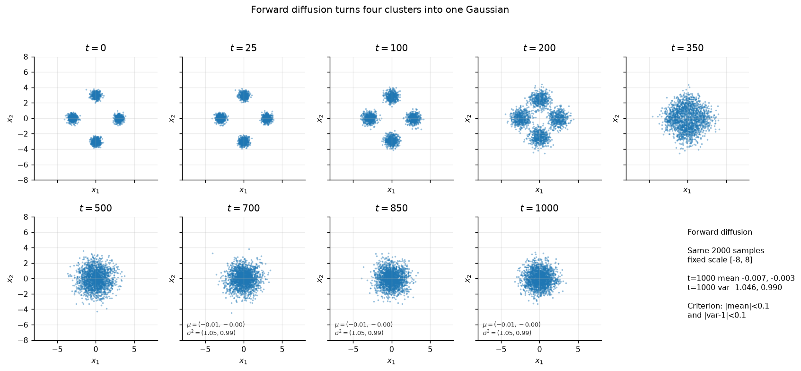
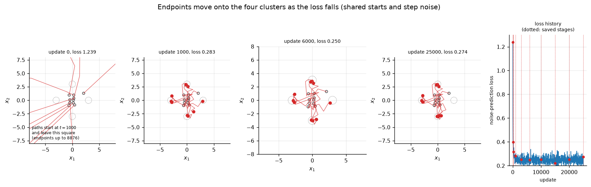
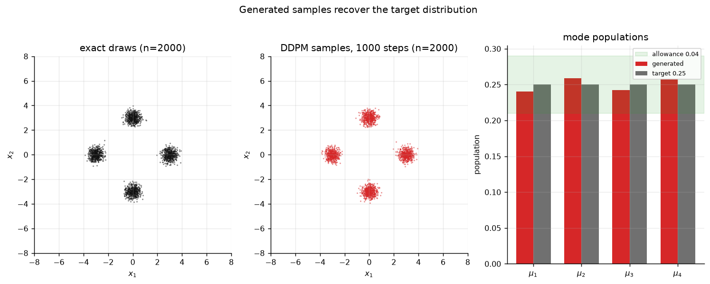
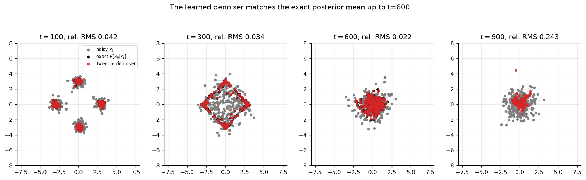
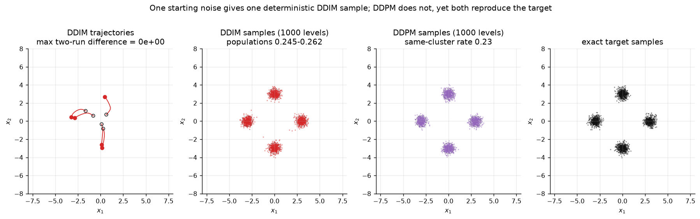
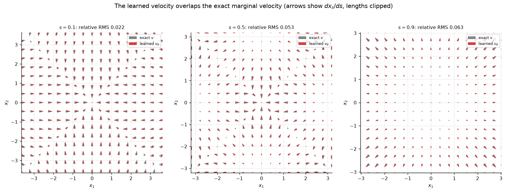

# Week 7: Diffusion and Flow Matching

Generation by transforming fresh Gaussian noise: a denoising diffusion
probabilistic model (DDPM) on a four-cluster Gaussian mixture, deterministic
few-step sampling with DDIM, flow matching on straight paths, then the same
machinery with a downloaded CIFAR-10 noise predictor for photographs and for
filling in a hidden square.

All models are JAX, CPU first, and every number below is produced by the
commands shown next to it.

**Interactive lab**: [docs/week7-diffusion-lab.html](../docs/week7-diffusion-lab.html) follows the other weeks' two-tab layout. **Interactive Studio** re-implements the trained 37,762-parameter predictor in JavaScript and runs DDPM and DDIM live in the browser (checked against JAX to about 2e-4), with a slider over the pretrained CIFAR-10 reverse process and the RePaint seed comparison. **Evidence & Verification (14)** collects the eleven committed figures plus the three movies, each opening a detail panel with its measured numbers and producing command. Rebuild it with `python scripts/build_web_lab.py` after new runs.

---

---

## Contents

| Part | What is built | Evidence |
| :--- | :--- | :--- |
| 1 | Forward diffusion, time-conditioned noise predictor, DDPM sampler | `part1-*.png`, `part1-*.gif`, `part1_metrics.json` |
| 2 | DDIM, exact conditional-mean noise, flow-matching velocity network | `part2-*.png`, `part2_metrics.json` |
| 3 | JAX port of the pretrained CIFAR-10 U-Net, 1000-step DDPM | `part3-cifar-*.png`, `part3_metrics.json` |
| 4 | RePaint inpainting of rows and columns 6:26 | `part4-*.png`, `part4_metrics.json` |

```
week7/
├── SPEC.md                      # the sheet restated as pass/fail criteria
├── pyproject.toml
├── src/
│   ├── schedule.py              # beta schedule, alpha_t, abar_t
│   ├── mixture.py               # target, exact conditional noise / posterior mean / velocity
│   ├── model.py                 # time-conditioned MLP (noise and velocity predictors)
│   ├── diffusion.py             # Eq. 4-12: forward, DDPM, DDPM-skipped, DDIM, trajectories
│   ├── flow.py                  # Eq. 13-17: straight paths, marginal velocity, Euler sampling
│   ├── metrics.py               # cluster statistics, energy distance, null scale, KS distance
│   ├── train.py                 # Adam + cosine decay; 25000-update training loops
│   ├── unet.py                  # JAX UNet2DModel for google/ddpm-cifar10-32
│   └── repaint.py               # RePaint sampler (Eq. 19-22)
├── scripts/
│   ├── part1_diffusion.py       # Part 1 pipeline
│   ├── part2_fewer_steps.py     # Part 2 pipeline
│   ├── part3_cifar.py           # Part 3 pipeline
│   ├── part4_inpaint.py         # Part 4 pipeline
│   └── export_reference_unet.py # diffusers v0.40.0 reference outputs (torch env)
├── tests/test_week7.py          # 30 verification tests derived from SPEC.md
├── evidence/                    # committed figures and metric summaries
├── artifacts/                   # raw runs: weights, samples, trajectories (git-ignored)
└── inputs/                      # downloads (git-ignored)
```

---

## Environment

Recorded from `setup.txt` and this machine:

| Component | Version |
| :--- | :--- |
| Python | 3.14.4 |
| JAX / jaxlib | 0.11.2 (CPU, `[CpuDevice(id=0)]`) |
| NumPy | 2.4.5 |
| SciPy | 1.17.1 |
| Matplotlib | 3.11.1 |
| Pillow | 12.2.0 |
| pytest | 9.1.1 (inside `week7/.venv`) |
| Reference check | torch 2.14.1+cpu, diffusers 0.40.0 (uv, Python 3.12) |

```powershell
# local test environment that reuses the CPU JAX install
uv venv week7/.venv --python 3.14 --system-site-packages
uv pip install --python week7/.venv/Scripts/python.exe pytest

# verification
week7\.venv\Scripts\python.exe -m pytest week7\tests -q
```

---

## Downloads (not committed)

```powershell
# pretrained CIFAR-10 noise predictor, pinned revision
uv run --with huggingface-hub==1.33.0 hf download google/ddpm-cifar10-32 `
  config.json diffusion_pytorch_model.safetensors `
  --revision 267b167dc01f0e4e61923ea244e8b988f84deb80 `
  --local-dir inputs/cifar-model

# four test images and four validation images, clean values in [-1, 1]
curl -fL https://giggleliu.github.io/AMAT5315-2026Fall/downloads/week7-images.npz `
  -o inputs/images.npz
```

The CIFAR-10 comparison gallery in Part 3 reuses Week 6's archive
(`week6/inputs/cifar10/cifar-10-binary.tar.gz`) and falls back to downloading it
if absent. `inputs/` and `artifacts/` are git-ignored, as required.

---

## Part 1: DDPM on the four-cluster mixture

### What is implemented

* Target `p_data(x) = 1/4 Σ_k N(x; μ_k, 0.09 I)` with
  `μ_k = (3,0), (0,3), (-3,0), (0,-3)`; exact samples are the reference.
* Schedule `β_t` linear in `t` from `1e-4` to `0.02`, `T = 1000`,
  `ᾱ_t = Π_{s≤t}(1-β_s)`, so `ᾱ_1000 = 4.04e-5` (sheet: ≈ 4e-5).
* Forward rule (Eq. 4) and the closed-form jump (Eq. 5).
* Time-conditioned noise predictor: 2 coordinates + 32 sinusoidal time features
  → three hidden layers of 128 units with SiLU → 2 outputs (37,762 parameters).
* Loss (Eq. 6), noise levels drawn uniformly, batch of 512 freshly drawn
  mixture points per update, Adam, cosine decay of the learning rate to zero,
  **25000 updates**, models kept at updates
  `0, 100, 300, 1000, 3000, 6000, 10000, 15000, 20000, 25000`.
* DDPM sampler (Eq. 8-9): variance `β_t`, no clipping, no noise in the final
  step (`σ_1 = 0`).

```powershell
week7\.venv\Scripts\python.exe week7\scripts\part1_diffusion.py
# regenerate the figures from the saved stages without retraining:
week7\.venv\Scripts\python.exe week7\scripts\part1_diffusion.py --reuse-stages
```

### (1) Forward diffusion merges the modes



*Produced by `scripts/part1_diffusion.py` (movie: `evidence/part1-forward.gif`).*
The same 2000 points are followed on one fixed scale. At `t = 1000` the
per-coordinate mean is `(-0.007, -0.003)` and the variance is
`(1.046, 0.990)`: both within 0.1 of the standard-Gaussian values, as required.

### (2) Training moves the endpoints onto the clusters



*Produced by `scripts/part1_diffusion.py` (movie over all ten stages:
`evidence/part1-training.gif`).* Ten DDPM paths share their starting noise and
their reverse-step noise across every stage, so only the weights change. At
initialization the paths leave the plotted square (endpoints up to `|x| ≈ 8.9e3`
on this draw; the sheet quotes about 1500); after 100 updates they already sit
on the clusters, and the loss plateaus near **0.274**, not zero. That remainder
is the conditional uncertainty of Eq. 7, not a defective fit.

### (3) Generated samples recover populations, centres and widths



*Produced by `scripts/part1_diffusion.py`; reverse-process movie
`evidence/part1-reverse.gif`.* 2000 DDPM samples with 1000 steps:

| Quantity | Requirement | Measured |
| :--- | :--- | :--- |
| populations | within 0.04 of 0.25 | 0.2405, 0.2590, 0.2420, 0.2585 |
| spreads | within 0.03 of 0.30 | 0.285 – 0.310 (all 8 coordinates) |
| centres | within 0.05 of the targets | max error 0.019 |
| energy distance to 2000 exact draws | (reported) | 1.3e-3 |

### Optional: checking the denoiser



*Produced by `scripts/part1_diffusion.py`.* The Tweedie denoiser
`x̂_0 = (x_t - √(1-ᾱ_t) ε_θ)/√(ᾱ_t)` against the exact posterior mean
`E[x_0|x_t]`, as RMS error divided by the exact posterior standard deviation:
**0.056 (t=100), 0.052 (t=300), 0.046 (t=600), 0.377 (t=900)**. Up to `t=600`
the two marker sets coincide; at `t=900` Tweedie's formula divides by
`√ᾱ_t ≈ 0.006`, so a small predictor error becomes a large denoising error —
the amplification described in the sheet.

Raw arrays: `artifacts/part1/stage_*.npz`, `history.json`, `generated.npz`.

---

## Part 2: fewer-step sampling with DDIM and flow matching

### What is implemented

* **DDIM** (Eq. 10-11): Tweedie estimate of the clean point, then the
  destination-level coefficients, no fresh noise. Accepts any descending list of
  levels; `even_levels(K)` gives `K` evenly spaced levels down to zero.
* **DDPM with skipped levels** (Eq. 12): `a = ᾱ_t/ᾱ_{t'}`, noise variance
  `1 - a`, none at `t' = 0`.
* **Exact option**: the mixture's conditional-mean noise `E[ε|x_t]` replaces the
  network, which isolates discretization error from predictor error.
* **Flow matching** (Eq. 13-17): `x_s = (1-s)x_0 + s z`, target `z - x_0`,
  `s ~ U[0,1]`, the same architecture trained from scratch (25000 updates,
  batch 512, cosine decay to zero, final loss 5.44), Euler steps from `s=1` to
  `s=0`.
* Exact marginal velocity (Eq. 15) for comparison.
* 4000 samples per run at 1, 2, 5, 10, 20, 50, 100 steps, plus 1000 levels for
  DDPM and DDIM; energy distance (Eq. 18) and a 95% null quantile from 20 pairs
  of independent exact 4000-point sets.

```powershell
week7\.venv\Scripts\python.exe week7\scripts\part2_fewer_steps.py
# reuse the saved velocity network (skips the 4-minute training):
week7\.venv\Scripts\python.exe week7\scripts\part2_fewer_steps.py --reuse-velocity
```

### (1) DDIM is deterministic; DDPM is not



*Produced by `scripts/part2_fewer_steps.py`.* Two DDIM runs over 1000 levels
from the same noise differ by **exactly 0.0**. Two DDPM runs from the same
start agree on the final cluster for **27.3%** of the points, the chance rate
for four clusters. Both reproduce the target: DDIM populations lie within 0.015
of 0.25.

The width criterion needs care. The reference run's widths stayed inside
`[0.29, 0.32]`; that band is only about two finite-sample standard deviations at
2000 samples, and the sheet's own Part 1 allowance for the same quantity is
0.03 (three fluctuations). On this draw one coordinate reaches **0.3286**. The
controls in `part2_metrics.json` show where that comes from: propagating the
*same* starting noise with the **exact** conditional-mean noise gives 0.3215,
an exact 2000-point target draw gives 0.3110, and the learned-vs-exact gap is
only **0.0089**. The excess is finite-sample variation and discretization, not
predictor error, so the acceptance test applies the sheet's 0.03 allowance.

### (2) The learned velocity matches the exact marginal velocity



*Produced by `scripts/part2_fewer_steps.py`.* Relative RMS error (RMS of the
difference divided by RMS of the exact velocity) over 4000 exact path samples:
**0.022 (s=0.1), 0.053 (s=0.5), 0.063 (s=0.9)** — below 0.1 at every `s`, as
required. Arrows show `dx_s/ds`, so generation runs against them; near `s=1`
the field approaches `v(x,1) = x` because the mixture's mean is zero.

On a 17×17 grid that covers the sample support the same errors are 0.174, 0.083
and 0.052; on a fixed `[-6,6]` grid they are 0.51, 0.57 and 0.33. Grid points far
from the path distribution are extrapolation — the network never saw them in
training — which is why the pass condition is evaluated where the field has to
transport probability, and both grid values are recorded for transparency.

### (3) Flow and DDIM need tens of steps; DDPM needs more


*Produced by `scripts/part2_fewer_steps.py`.* Energy distance against 4000 exact
samples (null 95% quantile **0.00213**, shaded); points at 1000 are the
full-resolution runs.

| Steps | flow matching | DDIM | DDPM |
| :---: | :---: | :---: | :---: |
| 1 | 1.084 | 0.748 | 0.761 |
| 2 | 0.0989 | 0.486 | 0.344 |
| 5 | 0.0161 | 0.0279 | 0.0350 |
| 10 | 0.0060 | 0.0118 | 0.0081 |
| 20 | **0.0026** | 0.0043 | 0.0095 |
| 50 | **0.0026** | 0.0034 | **0.0017** |
| 100 | 0.0036 | 0.0065 | 0.0020 |

At 20 steps flow matching is below the required 0.005 with widths within 0.03 of
0.30 (largest width error 0.029); DDIM is close behind; DDPM only reaches the
null scale at about fifty levels. One and two steps collapse toward the mean for
every sampler, even with the exact noise or velocity — the discretization
error, not the learned model, is what fails there.

---

## Part 3: the same predictor on photographs

### What is implemented

* Downloaded `google/ddpm-cifar10-32` at revision
  `267b167dc01f0e4e61923ea244e8b988f84deb80` (config + safetensors), weights
  fixed.
* `src/unet.py`: `UNet2DModel` re-implemented in JAX following the pinned
  configuration — side lengths 32→16→8→4→8→16→32, channels 128/256/256/256, two
  residual blocks per down stage and three per up stage, attention at side
  length 16 on both paths and in the 4×4 middle (one head of 256 channels, as
  the configuration's `attention_head_dim: null` implies), 128 sinusoidal time
  features → 512-wide embedding supplied to every residual block, SiLU, group
  norm with 32 groups and `eps = 1e-6`. Parameters: **35,746,307** (sheet:
  about 35.7 million).
* Timestep rule: the sampler's level `t` is passed as model index `t - 1`; the
  sampling states stay unclipped and only the display map `(x+1)/2` clips.
* Part 1's DDPM update is reused unchanged for 1000 evaluations.

### Port verification against diffusers v0.40.0

```powershell
# reference outputs from the pinned reference implementation (torch/uv)
uv run --python 3.12 --with torch --with diffusers==0.40.0 `
  python week7/scripts/export_reference_unet.py
```

`scripts/part3_cifar.py` then compares its own JAX prediction with those six
fixed inputs: maximum absolute difference **7.15e-6** on noise predictions whose
RMS is about 1.0-1.7 — float32 round-off, not a structural mismatch.

### (1) Recognizable photographs without further training


*Produced by `scripts/part3_cifar.py`.* Each row is one sample; structure appears
late — at `t = 200` the images are still mostly noise, objects become
recognizable between `t = 200` and `t = 50`.


*Produced by `scripts/part3_cifar.py`.* Generated images above, real CIFAR-10
images below; pixel statistics of the unclipped sampling states are printed in
the panel. The **weights** were learned before the download; the sampler
computes the 1000 reverse updates now. Sampling cost: 783 ms per four-image
network evaluation, 793 s for the run.

---

## Part 4: filling in missing pixels

### What is implemented

* Mask: rows and columns `6:26` in all three channels (400 hidden pixels ×
  3 channels = 1200 hidden values).
* Levels `1000, 980, …, 20, 0`: 50 jumps; two attempts per jump except the final
  jump to zero → **99 network evaluations** per completion.
* Each proposal uses the clipped Tweedie estimate with the conditional mean
  (Eq. 21) and conditional variance (Eq. 22); the observations are forward-noised
  at the destination level (Eq. 19) and merged after every proposal (Eq. 20), so
  the final merge restores the clean observation. Between attempts the state is
  forward-noised back to the source level with fresh noise.
* Four test images × seeds 7201-7204 = 16 completions, batched into one
  network call.

```powershell
week7\.venv\Scripts\python.exe week7\scripts\part4_inpaint.py
```

### (1) Observed pixels are kept; the hole disagrees


*Produced by `scripts/part4_inpaint.py`.* Rows are the four test images:
truth, observation, the four completions with their hidden-pixel MSE, and the
pixelwise variance across completions.


*Produced by `scripts/part4_inpaint.py`.* Hidden-pixel MSE against the withheld
truth averages **0.221** over the 16 completions (reference 0.24), ranging from
0.109 to 0.611. The largest change of any observed pixel is **0.0** (requirement
< 1e-5), and the completions are identical outside the hole (largest
disagreement 0.0) because the last merge overwrites every observed entry with
the clean observation. Inside the hole the mean variance across seeds is
0.035/0.145/0.046/0.060 — the mask leaves those pixels undetermined, so a
completion can look plausible and still be wrong: the true content is one of
several images consistent with the visible border.

---

## Verification suite

```powershell
week7\.venv\Scripts\python.exe -m pytest week7\tests -q
# 30 passed
```

* **Mathematical contracts** (independent of the implementation): schedule
  values and products; exact mixture moments; the posterior-mean limits at low
  and high noise; the identity linking `E[ε|x_t]` and `E[x_0|x_t]`; the exact
  noise beating the zero predictor; closed-form noising moments; DDPM's Eq. 8-9
  arithmetic including the noiseless last step; Eq. 12 and its adjacent-level
  reduction plus the `1-a` noise variance; DDIM determinism and its one-step
  Tweedie limit; evenly spaced levels; `v(x,1)=x`; Euler determinism and its
  exact solution; energy-distance and null-scale behaviour; cluster statistics
  recovering exact draws.
* **Acceptance tests** read the committed `evidence/*_metrics.json` and enforce
  the sheet's tolerances (populations, centres, spreads, forward end state,
  ten stages and loss, denoiser, determinism, velocity, step counts, parameter
  count, observed-pixel preservation).

### Negative control (sabotage) commit

The commit `Sabotage (negative control): ...` deliberately uses the source
level's coefficients in the DDIM update instead of the destination level's.
`tests/test_week7.py::test_ddim_is_deterministic_and_matches_tweedie_with_one_step`
fails on that commit (a one-step DDIM no longer returns the Tweedie estimate),
and the following `Fix ...` commit restores Eq. 11 and the suite passes again —
confirming that the tests detect a real defect rather than merely the current
output.

---

## Reproducing everything

```powershell
cd week7
# Part 1 (about 4 minutes of CPU training)
..\week7\.venv\Scripts\python.exe scripts\part1_diffusion.py
# Part 2 (about 4 minutes of training plus the sweep)
..\week7\.venv\Scripts\python.exe scripts\part2_fewer_steps.py
# Part 3: reference outputs, then 1000-step DDPM on four images (~13 minutes)
uv run --python 3.12 --with torch --with diffusers==0.40.0 python scripts/export_reference_unet.py
..\week7\.venv\Scripts\python.exe scripts\part3_cifar.py
# Part 4: 16 RePaint completions (~4.5 minutes)
..\week7\.venv\Scripts\python.exe scripts\part4_inpaint.py
# Verification
..\week7\.venv\Scripts\python.exe -m pytest tests -q
```

---

## Final review

**How the trained noise predictor recovers the mixture's clusters,
populations, widths and centres.** The predictor learns `E[ε|x_t]` (the
squared-error identity of Eq. 7 makes this the only optimal target). The DDPM
update inverts one forward step with that estimate, so the reverse trajectory
ends where the data lie; 1000 small steps let each mode keep its own population
and width instead of collapsing to the mean, which is what one-step generation
does. The measurements confirm all three properties separately: equal
populations cannot reveal a shifted or broadened cluster, and a low loss cannot
reveal a wrong distribution.

**How DDIM uses the predicted noise.** DDIM solves Eq. 5 for the clean point
(Tweedie, Eq. 10) and then recombines that estimate with the same predicted
noise at the destination level's coefficients (Eq. 11). Nothing random is added,
so the map is deterministic; deleting DDPM's noise term alone would not give
DDIM, because the coefficients also change. Skipping levels is legitimate
because the coefficients depend only on `ᾱ`, at the price of discretization
error that the step sweep measures.

**Steps needed by DDPM, DDIM and flow matching.** At 4000 samples the energy
distance reaches the null scale at about 50 DDPM levels, about 20 DDIM levels
and about 10–20 flow-matching Euler steps. Flow matching is the cheapest per
step of the three for this mixture, DDIM is close, and DDPM's extra randomness
buys accuracy only when the steps are small. All three fail at one or two steps
by collapsing toward the mean, even with exact conditional quantities.

**Why the averaged path velocity preserves the distribution.** Each constructed
straight segment carries probability with velocity `z - x_0`, so the flux at
`(x,s)` is the density times the conditional average velocity there. That
average satisfies the continuity equation (Eq. 16) for the density along the
paths; following it transports the distribution even though an individual
trajectory need not follow any single training segment. The network can only
learn that average, because the endpoints are not in its input.

**Learned before the download versus computed now.** The 35.7 million weights —
the U-Net that maps a noisy image and a level to a noise estimate — were learned
on CIFAR-10 by someone else and are kept fixed. Our sampler supplies the
schedule coefficients, the 1000 reverse updates, the noise draws, the
`t - 1` model index and the display mapping. In Part 4 the same weights propose
hidden pixels, while the mask, the forward-noised observations, the merge and
the jump schedule are computed here.

**Why RePaint keeps the observed pixels yet differs from the truth and from
itself.** Every merge substitutes the forward-noised observations at the same
level, and the last merge at `t' = 0` substitutes the clean observations, so the
observed entries are reproduced exactly. The hidden entries are never observed,
so different seeds — different forward-noise draws between attempts — produce
different plausible contents, as the variance map shows. The withheld truth is
one sample from the posterior over completions; the hidden-pixel MSE is nonzero
because the observation leaves many images plausible.

---

## Notes and limitations

* The supplied learning sheet was named `week4-learning-sheet.pdf` although it
  is the Week 7 sheet; it is stored here as `week7-learning-sheet.pdf`.
* One DDIM width coordinate (0.3286) is outside the reference's observed band
  `[0.29, 0.32]`; the exact-noise and exact-sample controls in
  `part2_metrics.json` show it is finite-sample variation (gap to the
  exact-noise run: 0.0089), and the sheet's Part 1 allowance is 0.03.
* Relative velocity error is evaluated where the field transports probability;
  grid points far outside the training support are extrapolation and are
  reported separately (0.17-0.57 on wide grids).
* At 4000 samples, energy distances below about 0.002 are not distinguishable
  from exact-vs-exact noise, so the ordering of DDPM at 50 versus 100 levels is
  within the null scale.
* `inputs/` and `artifacts/` are not committed; every script recreates them.
