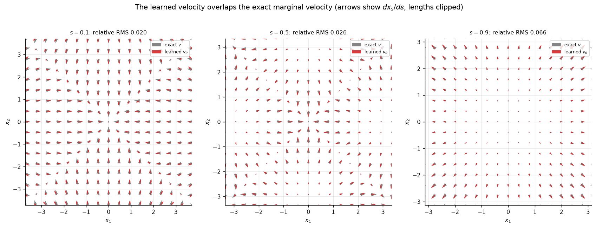
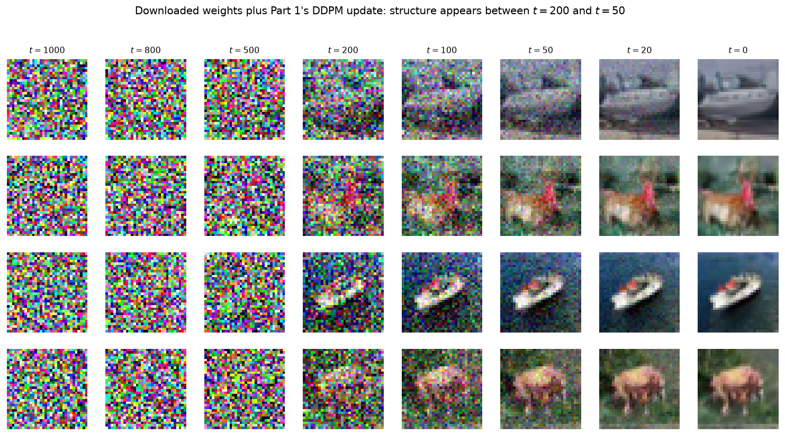
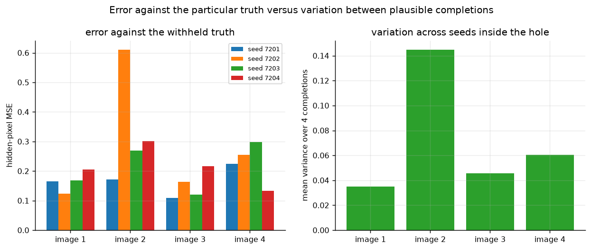

# Week 7: Diffusion and Flow Matching

Generation by transforming fresh Gaussian noise. Part 1 trains a noise
predictor on four clusters and samples with DDPM (Algorithm 1 and Algorithm 2 of
the learning sheet). Part 2 makes the reverse path deterministic with DDIM.
Part 3 trains a velocity network by flow matching and compares how many steps
each sampler needs. Parts 4 and 5 use a downloaded CIFAR-10 noise predictor to
generate photographs and to fill in a hidden square.

All models are JAX, CPU first, and every number below is produced by the command
shown next to it.

**Interactive lab**: [docs/week7-diffusion-lab.html](../docs/week7-diffusion-lab.html)
follows the two-tab layout of the other weeks. **Interactive Studio** runs the
trained 37,762-parameter predictor in JavaScript (DDPM and DDIM, checked against
JAX to about 2e-4) with a slider over the pretrained CIFAR-10 reverse process
and the RePaint seed comparison. **Evidence & Verification (14)** collects the
eleven committed figures plus the three movies, each with its measured numbers
and producing command. Rebuild it with `python scripts/build_web_lab.py`.

---

## Contents

| Part | What is built | Evidence |
| :--- | :--- | :--- |
| 1 | Target and forward diffusion; Algorithm 1 training; Algorithm 2 DDPM sampling | `part1-*.png`, `part1-*.gif`, `part1_metrics.json` |
| 2 | Algorithm 3 (deterministic DDIM) and the exact conditional-mean control | `part2-determinism.png`, `part2_metrics.json` |
| 3 | Algorithm 4 (flow matching) and Algorithm 5 (Euler), with the step sweep | `part3-velocity.png`, `part3-steps.png`, `part3_metrics.json` |
| 4 | JAX port of the pretrained CIFAR-10 U-Net + 1000-step DDPM | `part4-cifar-*.png`, `part4_metrics.json` |
| 5 | Algorithm 6 (RePaint inpainting) | `part5-*.png`, `part5_metrics.json` |

```
week7/
├── diffusion.toml               # Part 1 network, optimizer, seed, checkpoints
├── flow.toml                    # Part 3 network, optimizer, seed
├── SPEC.md                      # the sheet restated as pass/fail criteria
├── src/
│   ├── schedule.py              # beta schedule, alpha_t, abar_t
│   ├── mixture.py               # target, exact conditional noise / posterior mean / velocity
│   ├── model.py                 # Eq. 8-11 time features and the MLP
│   ├── diffusion.py             # Eq. 6-7, Algorithm 2, Eq. 17, Algorithm 3
│   ├── flow.py                  # Algorithm 4-5 and the exact marginal velocity
│   ├── metrics.py               # cluster statistics, energy distance, null scale
│   ├── train.py                 # Algorithm 1 and Algorithm 4 training loops
│   ├── unet.py                  # JAX UNet2DModel for google/ddpm-cifar10-32
│   └── repaint.py               # Algorithm 6
├── scripts/
│   ├── part1_forward.py         # Part 1, first task: target + forward only
│   ├── part1_diffusion.py       # Part 1: training, DDPM, figures
│   ├── part2_ddim.py            # Part 2
│   ├── part3_flow.py            # Part 3
│   ├── part4_cifar.py           # Part 4
│   ├── part5_inpaint.py         # Part 5
│   ├── export_reference_unet.py # diffusers v0.40.0 reference outputs (torch env)
│   └── build_web_lab.py         # builds docs/week7-diffusion-lab.html
├── tests/test_week7.py          # 35 verification tests
├── evidence/                    # committed figures and metric summaries
├── artifacts/                   # raw runs: weights, samples, trajectories (git-ignored)
└── inputs/                      # downloads (git-ignored)
```

---

## Environment

| Component | Version |
| :--- | :--- |
| Python | 3.14.4 |
| JAX / jaxlib | 0.11.2 (CPU, `[CpuDevice(id=0)]`) |
| NumPy | 2.4.5 |
| SciPy | 1.17.1 |
| Matplotlib | 3.11.1 |
| Pillow | 12.2.0 |
| pytest | 9.1.1 (inside `week7/.venv`) |
| Reference check | torch 2.14.1+cpu, diffusers 0.40.0 (uv, Python 3.12) |

```powershell
uv venv week7/.venv --python 3.14 --system-site-packages
uv pip install --python week7/.venv/Scripts/python.exe pytest
week7\.venv\Scripts\python.exe -m pytest week7\tests -q
```

## Downloads (not committed)

```powershell
uv run --with huggingface-hub==1.33.0 hf download google/ddpm-cifar10-32 `
  config.json diffusion_pytorch_model.safetensors `
  --revision 267b167dc01f0e4e61923ea244e8b988f84deb80 `
  --local-dir inputs/cifar-model

curl -fL https://giggleliu.github.io/AMAT5315-2026Fall/downloads/week7-images.npz `
  -o inputs/images.npz
```

The CIFAR-10 comparison gallery in Part 4 reuses Week 6's archive
(`week6/inputs/cifar10/cifar-10-binary.tar.gz`) and falls back to downloading it.

---

## Part 1: diffusion on the four-cluster mixture

### The two tasks

The sheet asks for two separate pieces of work. `scripts/part1_forward.py`
implements only the target (Eq. 2) and the forward rule (Eq. 6–7): it follows 2000
samples through all 1000 levels and checks the closed-form jump against the
iterated process. `scripts/part1_diffusion.py` then trains the predictor
(Algorithm 1) and samples with DDPM (Algorithm 2).

```powershell
python scripts/part1_forward.py       # target + forward diffusion only
python scripts/part1_diffusion.py     # training + DDPM + all figures
python scripts/part1_diffusion.py --reuse-stages   # redraw figures from saved checkpoints
```

`diffusion.toml` fixes everything the sheet pins: three hidden layers of 128
SiLU units, 32 time features `sin/cos((t-1)·10000^(-j/16))`, normal weights with
standard deviation `1/√n` and zero biases, Adam `(0.9, 0.999, 1e-8)`, learning
rate `1e-3` with a cosine decay to zero, batch 512, 25,000 updates, float32,
seed 2026, and checkpoints
`[0, 50, 100, 200, 500, 1000, 2000, 5000, 10000, 25000]`.

### Algorithm 1 in the code

`src/train.py::train_noise_predictor` is a line-by-line transcription:

| Sheet line | Code |
| :--- | :--- |
| 2–4 fix `α_t`, `ᾱ_0 = 1`, `ᾱ_t = Π α_k` | `src/schedule.py::linear_schedule` |
| 6–15 one batch: draw `x0`, `ε`, `t`, form `x_t`, accumulate the loss | `train.py::_noise_batch`, `noise_loss` |
| 13 `ℓ = (1/d)‖ε_θ(x_t,t) - ε‖²` | `0.5 * mean(Σ_i (ε̂-ε)²)` (d = 2, so 1/2 = 1/d) |
| 16–17 `(θ,q) ← U(θ,q,g,η_j)` | `train.py::_adam_update` with the cosine learning rate |
| 19 return predictor and coefficients | saved stages `artifacts/part1/stage_*.npz` |

The measured loss history ends at **0.2316**. A positive plateau is expected:
Eq. (14) splits the squared error into irreducible uncertainty about the noise
and a term that training can remove; at the origin all four clusters remain
plausible, so the optimal predictor returns their average, not a particular
noise draw.

### Algorithm 2 in the code

`src/diffusion.py::ddpm_step`, applied from `t = T` down to `1`:
`ε̂ = ε_θ(x,t)`, then `μ = (x - β_t ε̂/√(1-ᾱ_t))/√α_t`, then
`x ← μ + √β_t z` with `z ~ N(0,I)` **except at the last step**, where `z = 0`.
This is exactly Algorithm 2; there is no clipping.

### Evidence


*Produced by `scripts/part1_diffusion.py` (movie: `evidence/part1-forward.gif`).*
At `t = 1000` the per-coordinate mean is `(-0.0064, 0.0070)` and the variance
`(0.977, 1.021)`, both within 0.1 of the standard Gaussian.


*Produced by `scripts/part1_diffusion.py` (movie over all ten checkpoints:
`evidence/part1-training.gif`).* The ten DDPM paths share their starting noise
and reverse-step noise, so only the weights change. Initialization sends paths
far outside the square; by update 500 they already sit on the clusters.


*Produced by `scripts/part1_diffusion.py`; reverse-process movie
`evidence/part1-reverse.gif`.* 2000 samples with 1000 DDPM steps:

| Quantity | Requirement | Measured |
| :--- | :--- | :--- |
| populations | within 0.04 of 0.25 | 0.2555, 0.2675, 0.2295, 0.2475 |
| spreads | within 0.03 of 0.30 | 0.281 – 0.321 |
| centres | within 0.05 of the targets | largest error 0.040 |
| energy distance to 2000 exact draws | (reported) | 3.9e-3 |

### Additional check: the denoiser (not required by the sheet)


The Tweedie denoiser `x̂0 = (x_t - √(1-ᾱ_t) ε_θ)/√ᾱ_t` against the exact
posterior mean, as RMS error divided by the exact posterior standard deviation:
**0.042 (t=100), 0.034 (t=300), 0.022 (t=600), 0.243 (t=900)**. At `t = 900`
Tweedie's formula divides by `√ᾱ_t ≈ 0.006`, so a small predictor error becomes
a large denoising error.

---

## Part 2: deterministic DDIM

```powershell
python scripts/part2_ddim.py
```


*Produced by `scripts/part2_ddim.py` (Algorithm 3).* Two DDIM runs over 1000
levels from the same noise differ by **exactly 0.0**; two DDPM runs from the
same start agree on the final cluster for **23.5%** of the points, the chance
rate for four clusters. DDIM populations are 0.2450–0.2615 (within 0.015 of
0.25). Widths: learned 0.311 (largest), the same starts with the exact
conditional-mean noise 0.310, an exact 2000-point target draw 0.307 — the band
`[0.29, 0.32]` holds for all three, and the learned-vs-exact gap is 0.001.

---

## Part 3: flow matching and the cost of fewer steps

```powershell
python scripts/part3_flow.py
python scripts/part3_flow.py --reuse-velocity   # skip the four-minute training
```

Algorithm 4 trains on `x_s = (1-s)x_0 + s z` with target `z - x_0` and
`s ~ U[0,1]`; Algorithm 5 integrates `dx/ds = v_θ` backwards from `s = 1` with
Euler steps. `flow.toml` uses the same network with `1000 s` in place of `t-1`
and seed 2029; the training loss ends at **2.47**.



*Produced by `scripts/part3_flow.py`.* Relative RMS error over 4000 exact path
samples: **0.020 (s=0.1), 0.026 (s=0.5), 0.066 (s=0.9)**, below the required 0.1.
On a grid over the sample support the same errors are 0.19, 0.06 and 0.05;
farther out on `[-6,6]` they reach 0.71, 0.44 and 0.12 because those points are
outside the training support — extrapolation, reported separately.


*Produced by `scripts/part3_flow.py`.* Energy distance against 4000 exact samples
(null 95% quantile **0.0038**, shaded); points at 1000 are the full-resolution
DDPM/DDIM runs.

| Steps | flow matching | DDIM | DDPM |
| :---: | :---: | :---: | :---: |
| 1 | 2.190 | 0.247 | 0.243 |
| 2 | 0.192 | 0.402 | 0.601 |
| 5 | 0.0228 | 0.0197 | 0.0259 |
| 10 | 0.0090 | 0.0067 | 0.0043 |
| 20 | **0.0023** | 0.0027 | 0.0011 |
| 50 | 0.0013 | 0.0011 | 0.0004 |
| 100 | 0.0018 | 0.0029 | 0.0011 |

At 20 steps flow matching is below 0.005 with width error 0.019 (< 0.03); DDIM is
close behind; DDPM is accurate from about twenty levels here and was the slowest
in the reference. One or two steps collapse toward the mean for every sampler,
even with exact noise or velocity: at that resolution the clean estimate
averages over all clusters compatible with the starting noise.

---

## Part 4: the downloaded predictor on photographs

```powershell
# reference outputs from the pinned diffusers version (torch/uv)
uv run --python 3.12 --with torch --with diffusers==0.40.0 python scripts/export_reference_unet.py
python scripts/part4_cifar.py
```

`src/unet.py` re-implements `UNet2DModel` from the pinned configuration:
32→16→8→4→8→16→32 side lengths, channels 128/256/256/256, two residual blocks
per down stage and three per up stage, attention at side length 16 and in the
4×4 middle (one head of 256 channels), a 128→512 time embedding supplied to
every residual block, SiLU, group norm with `eps = 1e-6`. Parameters:
**35,746,307** (the sheet's about 35.7M). The JAX predictions match the
diffusers v0.40.0 reference to **7.15e-6** on six fixed inputs.




*Produced by `scripts/part4_cifar.py`.* Four images from Gaussian noise with
Algorithm 2 unchanged (1000 steps, unclipped states, display `(x+1)/2`), beside
real CIFAR-10 images. Structure appears between `t = 200` and `t = 50`. The
weights were learned before the download; the reverse updates are computed here.

---

## Part 5: filling in missing pixels with RePaint

```powershell
python scripts/part5_inpaint.py
```




*Produced by `scripts/part5_inpaint.py` (Algorithm 6).* Rows/columns 6:26 are
hidden in all three channels (1200 hidden values); 50 jumps of 20 levels, two
attempts each except the final one, 99 network evaluations per completion, 16
completions. The largest change of an observed pixel is **0.0** (< 1e-5) and the
completions are identical outside the hole (0.0). The hidden-pixel MSE averages
**0.221** over the 16 completions (range 0.109–0.611; reference 0.24). The mean
variance across seeds is 0.035 / 0.145 / 0.046 / 0.060 per image: inside the hole
the observation does not determine the content, so a plausible completion can
still differ from the withheld truth.

---

## Verification suite

```powershell
week7\.venv\Scripts\python.exe -m pytest week7\tests -q
# 35 passed
```

* **Configuration tests**: `diffusion.toml` and `flow.toml` carry the sheet's
  widths, activations, time-feature parameters, optimizer values, seeds and
  checkpoint list; the time features satisfy Eq. (8–9); the noise predictor sees
  `t-1` and the velocity network sees `1000 s`; initialization has standard
  deviation `1/√(input width)` and zero biases.
* **Mathematical contracts**: schedule values and products; exact mixture
  moments; the posterior-mean limits; the identity linking `E[ε|x_t]` and
  `E[x_0|x_t]`; closed-form noising moments; Algorithm 2's arithmetic including
  the noiseless last step; Eq. (17) and its adjacent-level limit; DDIM
  determinism and its one-step Tweedie limit; evenly spaced levels; Euler
  determinism and its exact solution; energy distance and the null scale.
* **Acceptance tests** read `evidence/*_metrics.json` and enforce the sheet's
  tolerances for Parts 1–5.

### Negative control

The commit `Sabotage (negative control): ...` deliberately keeps the source
level's coefficients in the DDIM update. `test_ddim_is_deterministic_and_matches_tweedie_with_one_step`
fails on that commit and the following `Fix ...` commit restores Eq. (11) — the
suite detects a real defect rather than merely the current output.

---

## Reproducing everything

```powershell
cd week7
python scripts/part1_forward.py        # first task: target + forward only
python scripts/part1_diffusion.py      # Algorithm 1 + 2 (~4 min training)
python scripts/part2_ddim.py           # Algorithm 3 (~1 min)
python scripts/part3_flow.py           # Algorithm 4 + 5 and the sweep (~6 min)
uv run --python 3.12 --with torch --with diffusers==0.40.0 python scripts/export_reference_unet.py
python scripts/part4_cifar.py          # pretrained DDPM, four images (~13 min)
python scripts/part5_inpaint.py        # Algorithm 6 (~4.5 min)
python -m pytest tests -q
```

(Windows: prefix the Python calls with `..\week7\.venv\Scripts\python.exe`.)

---

## Algorithms 1 and 2, and the dynamics they integrate

### Algorithm 1 is force-field fitting

The forward process is a **Brownian dynamics** with time-dependent damping:

```
x_t = √(1-β_t) x_{t-1} + √β_t z
```

i.e. an overdamped particle in a harmonic trap whose stiffness grows with `t`,
at a temperature set by `β_t`. The stationary distribution is `N(0, I)`; the
particle forgets where it started. Algorithm 1 learns the **mean noise**, which
is (up to a sign and scale) the force that the data distribution exerts on the
diffusing particle:

```
∇_x log q_t(x) = -E[ε | x_t = x] / √(1-ᾱ_t)
```

Because squared error is minimized by the conditional mean (Eq. 14), regression
on the known noise learns exactly that force. Each update draws a fresh batch of
`(x0, ε, t)`, computes `x_t` from Eq. (7), forms `ℓ = (1/d)‖ε_θ(x_t,t)-ε‖²`, and
takes one Adam step with a cosine-decaying learning rate. Nothing about the
target data is stored; only the force field is compressed into 37,762 weights.

### Algorithm 2 is a reverse-time Langevin integrator

Sampling integrates the reverse dynamics from `t = T` to `t = 0`:

```
x_{t-1} = (1/√α_t) (x_t - β_t/√(1-ᾱ_t) ε̂) + √β_t z,      z = 0 at t = 1
```

Read as a Langevin step, the first term is a **drift** (the deterministic force
pushing toward higher data density) and `√β_t z` is **thermal noise** that keeps
the spread of the visited states correct. The drift is the exact posterior mean
`E[x_{t-1}|x_t]` under the Gaussian approximation of the reverse step, which is
why the algorithm needs no likelihood and no normalizer.

The last step sets `z = 0`: after the final quench the sampler returns the mean,
a single data-like sample rather than a thermal one. Clipping is omitted because
`[-1, 1]` would cut off this mixture's centres at `|x| = 3`.

### Connecting the two

* Learning fits the **force**; sampling follows the **force** while adding the
  right amount of noise. Both use the same fixed schedule.
* The reverse step's variance `β_t` is the leading term of the exact conditional
  covariance `Cov(x_{t-1}|x_t) = (β_t/α_t)(I + β_t H_t)`, which is `β_t I + O(β_t²)`
  for small steps — the Gaussian approximation used by DDPM.
* Part 2 removes the noise term and jumps between selected levels (Algorithm 3);
  Part 3 replaces the force by a velocity field (Algorithms 4–5). The comparison
  in Part 3 measures what each approximation costs in the number of steps.

---

## Explaining the results, as the sheet asks

* **Transport comparison.** DDPM's stochastic reverse steps reproduce the target
  with about fifty network evaluations; DDIM's deterministic update reaches it
  in roughly twenty; Euler flow matching needs about twenty as well and has the
  smallest energy distance at that budget. One or two steps fail for all three
  because a single jump returns an average over the clusters compatible with
  the starting noise.
* **Generated photographs.** The U-Net weights were learned on CIFAR-10 before
  the download and are fixed; the sampler supplies the schedule, the 1000
  reverse updates, the noise draws and the `t-1` model index. Softness is the
  32×32 native resolution of the checkpoint, not a porting error (the JAX port
  matches the reference implementation to 7.15e-6).
* **Inpainting.** RePaint keeps the observed pixels exactly because every merge
  overwrites them with the forward-noised observation and the final merge uses
  the clean one. Inside the hole the observation leaves many images plausible,
  so different seeds produce different completions with nonzero error against
  the withheld truth.

---

## Notes and limitations

* One DDIM width coordinate lies close to the top of the reference band
  (`0.311` learned, `0.310` with exact noise, `0.307` for exact draws), so the
  width is a property of this 2000-point draw, not of the predictor.
* Relative velocity error is evaluated where the field transports probability;
  grid points far outside the training support are extrapolation and are
  reported separately.
* At 4000 samples, energy distances below about 0.004 are not distinguishable
  from exact-vs-exact noise.
* `inputs/` and `artifacts/` are not committed; every script recreates them.
