# Week 8: Language models and the transformer

Six completed parts of the [official learning sheet](https://giggleliu.github.io/AMAT5315-2026Fall/week8-learning-sheet.html): embedding geometry, count language models, memory capacity and an MLP, picture recall with attention, a trained transformer, and a refit of the Chinchilla scaling law. The local [24-page PDF](week8-learning-sheet.pdf) matches the official version byte for byte.

**[Open the interactive lab](https://imgrj.github.io/AMAT5315-2026Fall-Exercise/week8-language-lab.html)** · [Specification](SPEC.md) · [Numerical acceptance results](evidence/acceptance.json)

The upper-right switch follows Week 7: **Interactive Studio** contains the memory, token-sampling and scaling controls; **Evidence & Verification (14)** contains the computed metrics, checks and 14 figures. Switching preserves control settings. Arrow keys, Home and End also select views. On narrow screens, the switch moves below the title.

On 2026-10-28, a fresh official PDF download matched the supplied and committed PDF byte for byte (SHA256 `4e33bea929459c01511efc0298308a93d08d99ee7df38372bbf52e89be69cc35`). This layout revision therefore retains the existing calculations and evidence.

The transformer reaches **1.220 bits per character**, below the best count model's **1.310**. All **34 unit tests** and **49 full-experiment acceptance checks** pass. An independent reviewer also reconstructed the token streams and checked the transformer against NumPy through the context-window rollover.

## Reproduce

From the repository root, using Python 3.14 and uv:

```powershell
uv venv week8/.venv --python 3.14
uv pip install --python week8/.venv/Scripts/python.exe -r week8/requirements.txt
cd week8
.venv\Scripts\Activate.ps1
python scripts/download_data.py
python -m pytest tests -q
python scripts/part1_embeddings.py
python scripts/part2_counts.py
python scripts/part3_memory.py
python scripts/part3_mlp.py
python scripts/part4_attention.py
python scripts/part5_transformer.py
python scripts/part5_evaluate.py
python scripts/part6_scaling.py
python scripts/verify_results.py
python scripts/build_web_lab.py
```

On Linux/macOS, use `.venv/bin/python` or activate with `source .venv/bin/activate`. Commands below assume this environment is active and the working directory is `week8/`. CPU is selected explicitly. The run used Python 3.14.4, JAX/jaxlib 0.12.0.1, Optax 0.2.8, NumPy 2.5.4, SciPy 1.18.1, Matplotlib 3.11.1, SentencePiece 0.2.2, and pytest 9.2.0. Exact direct dependencies are in [requirements.txt](requirements.txt). On an Intel Core Ultra 7 356H, the MLP took 28 seconds and transformer training 226 seconds; these timings include compilation and some concurrent work, and are not hardware-independent benchmarks.

The training scripts reproduce the full prescribed budgets. Raw weights, token arrays, memory trials, bootstrap samples and settings remain in ignored `artifacts/`. The committed lab contains recorded recall arrays and logits for four fixed prefixes, so it works without downloading or retraining a model. It transforms and samples those next-token distributions in the browser; the displayed longer stories were generated by JAX.

```text
week8/
  SPEC.md, PLAN.md, README.md       requirements, execution record, guide
  src/                            data, embeddings, counts, memories,
                                  JAX models/training/generation, scaling
  scripts/                        pinned downloads, six experiments, audit,
                                  GitHub Pages lab builder
  tests/                          independent fixtures and numerical checks
  evidence/                       14 figures, metrics, corpus/source manifests
  web/lab_template.html           source for the interactive lab
  data/                           ignored downloaded sources
  artifacts/                      ignored raw runs, weights and settings
```

## Sources and tokenizer

[sources.json](evidence/sources.json) records the download URL, byte count and SHA256 for every input. `python scripts/download_data.py` downloads:

| Input | Pinned source |
| :--- | :--- |
| Pretrained word vectors | [minishlab/potion-base-8M, bf8b056](https://huggingface.co/minishlab/potion-base-8M/tree/bf8b056): `model.safetensors`, `tokenizer.json` |
| Stories | [TinyStoriesV2-GPT4-valid.txt, f54c09fd23315a6f9c86f9dc80f725de7d8f9c64](https://huggingface.co/datasets/roneneldan/TinyStories/resolve/f54c09fd23315a6f9c86f9dc80f725de7d8f9c64/TinyStoriesV2-GPT4-valid.txt) |
| BPE tokenizer | [karpathy/tinyllamas, 0bd21da/stories260K/tok512.model](https://huggingface.co/karpathy/tinyllamas/resolve/0bd21da/stories260K/tok512.model) |
| Scaling runs | [Epoch replication data, 92258837425e1b5f2851d624287f0120583a3d0e](https://raw.githubusercontent.com/epoch-research/analyzing-chinchilla/92258837425e1b5f2851d624287f0120583a3d0e/data/svg_extracted_data.csv) |

The embedding tokenizer and the language-model tokenizer are different. Part 1 looks up single word-piece rows in a **29,528 × 256** pretrained table, loaded directly with safetensors and tokenizers, without PyTorch. Parts 2–5 use the same **512-token SentencePiece BPE** vocabulary: three special tokens, 256 byte fallbacks and 253 merged pieces. Frequent pieces cover multiple characters; arbitrary text falls back to bytes.

Splitting at `<|endoftext|>`, stripping surrounding whitespace and dropping empty stories gives **24,867 training / 2,763 validation stories**, in file order. Each encoded stream starts with EOS and appends EOS after every story. There are **9,667,036 / 1,078,997 tokens** including the initial EOS, and **2.05183 validation characters per predicted token**. The character denominator is the sum of the original stripped validation story lengths, excluding separators. Exactly three validation stories (zero-based indices 50, 819, 2017) change on round trip: the tokenizer merges a double space. Details: [corpus.json](evidence/corpus.json).

## Part 1 — Meaning becomes geometry

`python scripts/part1_embeddings.py`

Normalize each word vector, form each pair's offset, and compare it with the mean offset of the **other eight pairs**. Self-inclusion would create a spurious positive cosine. The exact nine pairs for each relation are retained in [part1_metrics.json](evidence/part1_metrics.json).

| Relation | Trained mean cosine | Shuffled rows, seed 1730 |
| :--- | ---: | ---: |
| Country → capital | 0.4659 | 0.0295 |
| Male → female | 0.5485 | −0.0148 |
| Adjective → comparative | 0.4330 | 0.0088 |

All trained means exceed 0.3; all controls lie within ±0.15. Twenty additional deterministic shuffles are recorded. Each arrow below has unit length; its horizontal component is the leave-one-pair-out cosine. Shared directions disappear when words receive other words' vectors.

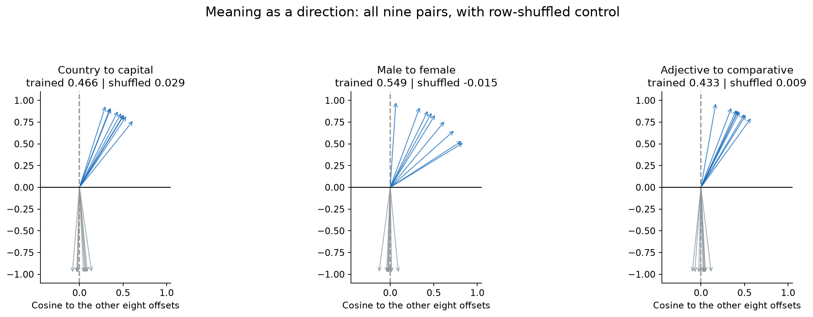

## Part 2 — Count models and the dimensionality limit

`python scripts/part2_counts.py`

An n-gram keeps the last n−1 tokens. Counts give
`p(next|context) = (count(context,next)+k)/(count(context)+512k)`.
Choose k from `0.0001, 0.001, 0.01, 0.1, 1` using the last 10% of **training tokens**, then refit on the full training split. Validation is never used to choose k. Unseen contexts are exactly uniform.

| Model | k | Nats/token | Perplexity | Bits/character | Unseen n-grams |
| :--- | ---: | ---: | ---: | ---: | ---: |
| Uniform | — | 6.2383 | 512.000 | 4.3863 | — |
| Unigram | 0.0001 | 4.8394 | 126.394 | 3.4027 | 0% |
| Bigram | 0.01 | 3.0382 | 20.867 | 2.1362 | 0.0265% |
| Trigram | 0.01 | 2.0943 | 8.120 | 1.4726 | 0.6328% |
| 4-gram | 0.01 | 1.8627 | 6.441 | **1.3097** | 4.1509% |
| 5-gram | 0.01 | 2.0825 | 8.025 | 1.4643 | 12.2244% |
| 6-gram | 0.001 | 2.5504 | 12.812 | 1.7932 | 23.4992% |

Perplexity is `exp(loss)`. Bits/character is loss divided by `ln(2)`, times predicted tokens per original character. For n-grams the first n−1 stream tokens supply the initial context; the dropped prefix changes the scoring count by at most five tokens. The common corpus conversion factor is used for comparison.

All 512, 512² and 512³ possible length-1/2/3 bigram continuations were explicitly enumerated from EOS, with maximum mass error **3.2e−15**. Each next-token factor sums to one, so repeated summation also proves normalization for arbitrary fixed length. A 250,000-token ancestral sample passes the pooled 20-context chi-square test (**p=0.7103**). Rare expected categories are grouped to at least five observations. Conditioning on the token **two places back** produces p=0; unnormalized exponential scores also fail the mass check.

The 4-gram wins. By order six, almost a quarter of held-out n-grams are absent, and the model falls behind the trigram. More context increases the number of possible rows faster than the corpus can fill them.

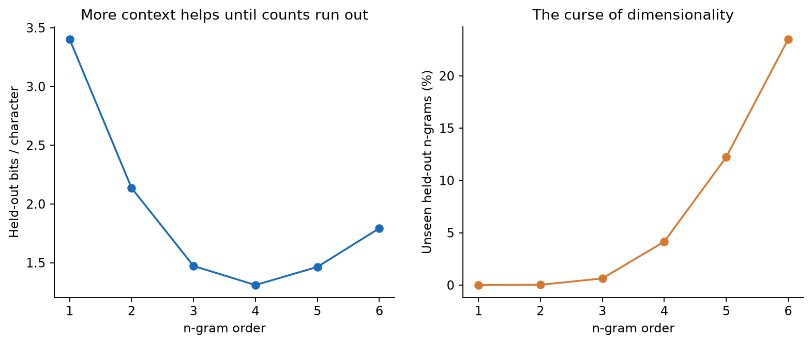

## Part 3 — Memories in weights

`python scripts/part3_memory.py`

Keys and values are independent random unit vectors. The outer-product store uses `W=VᵀK`; least squares uses `W=Vᵀpinv(Kᵀ)`; nonlinear stores use `Vᵀ ReLU(Kx)^p`. We measure the norm of interference divided by the matching memory's own signal. For least squares, the signal coefficient is the diagonal of the projection matrix, **not one**.

The sweep covers dimensions 16, 32, 64 and every power-of-two memory count from 8 to 65,536, with three independent draws. For M≤512 every key is queried; larger stores use 512 stored keys to estimate RMS interference. The plotted curve is the median of the three RMS estimates, not an exhaustive average over all 65,536 queries. Capacities are interpolated in log-log coordinates.

| Store | Capacity at d=64 | Capacity exponent vs d |
| :--- | ---: | ---: |
| Outer product | 63.87 | 0.907 |
| Least squares | 127.98 | 1.000 |
| ReLU | 133.53 | 1.044 |
| ReLU² | 2,811.44 | 1.904 |
| ReLU³ | 38,650.48 | 2.837 |

The interference-growth exponents are 0.498–0.508, close to √M. Least-squares recall is exact through 64 memories to **1.83e−13**. Its √(M/d−1) threshold is excluded when fitting the large-M growth slope. Shared key direction with mean pair similarity 0.3 collapses outer-product capacity to roughly 8–12 at all dimensions; the d=16 crossing is below the sweep's lower bound and plotted at 8.

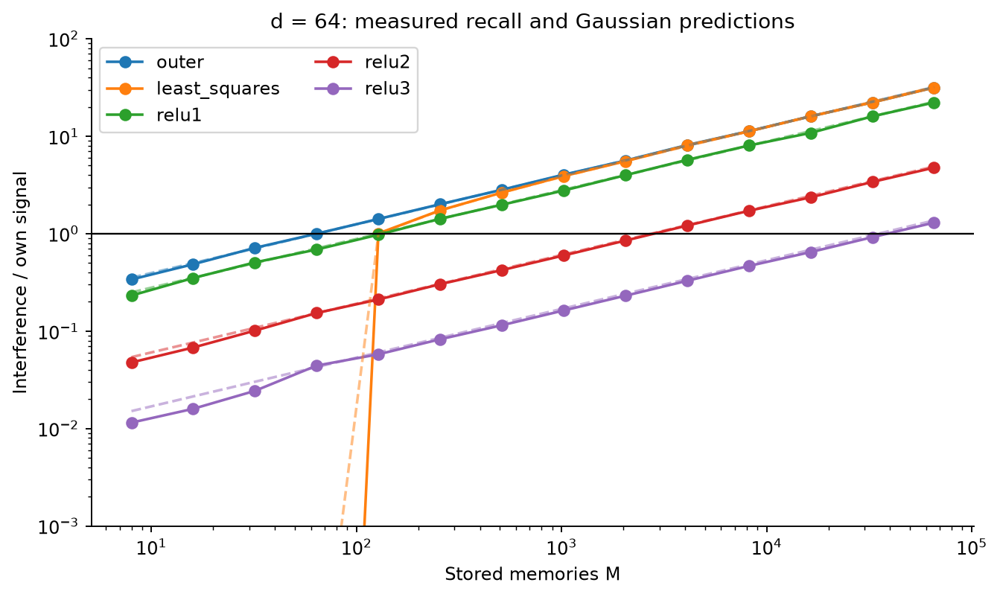

`python scripts/part3_memory.py`

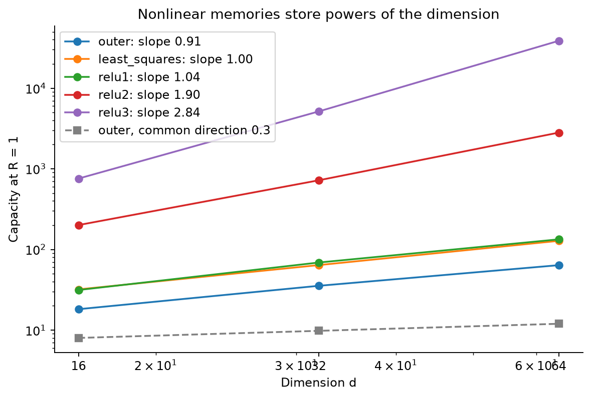

`python scripts/part3_mlp.py`

The language MLP has a 64-dimensional token embedding, 512 tanh units and a 512-logit readout. It trains for **4,000 AdamW steps × 16,384 examples**, peak LR 0.006, 200 warmup steps, cosine decay to 10%, weight decay 0.01, seed 1833. Repeated predecessor tokens share identical logits: each sampled batch is aggregated into a pair-count matrix, giving the **same loss and gradient** as the 16,384 individual examples while reducing redundant work.

Held-out loss is **3.04314**, only **+0.00495 nats/token** above the bigram. The MLP sees one previous token, so its weights approximate the same table. This verifies training; it does not demonstrate long-context modeling. The optional hidden-unit audit records the top five positive/negative input and output tokens per unit, and activation concentration, in `artifacts/mlp-units.json`; a compact selection is in [part3_mlp_metrics.json](evidence/part3_mlp_metrics.json). Individual units mix word pieces rather than forming clean one-fact dictionaries.

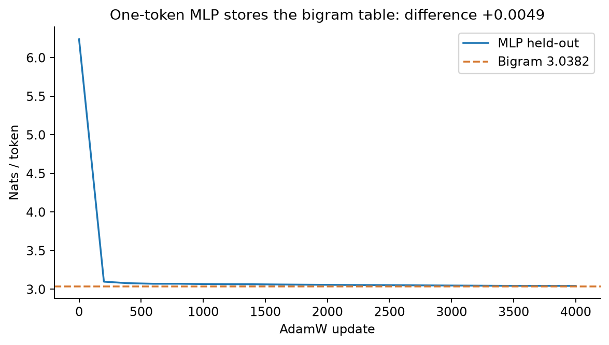

## Part 4 — A memory written by context

`python scripts/part4_attention.py`

The value is a 32×32 raster of **算**, with ink +1 and background −1, as in the sheet's Figure 13. The PDF's text extraction loses this glyph, but the figure shows it. The committed [character raster](evidence/character.png) makes reproduction independent of font availability. All other values are random ±1 pictures, with independent random unit keys in d=64.

| Memories | Outer R | ReLU R | ReLU² R | Softmax R, β=8 |
| ---: | ---: | ---: | ---: | ---: |
| 64 | 1.015 | 0.723 | 0.159 | 0.0071 |
| 256 | 1.991 | 1.433 | 0.302 | 0.0141 |
| 1,024 | 4.002 | 2.794 | 0.595 | 0.0280 |
| 4,096 | 7.969 | 5.640 | 1.217 | **0.0569** |

These are medians over **20 draws**, seeds 1840–1859. The gallery shows the first draw and prints its own R values. Every softmax row remains below 0.1; ReLU² fails at 4,096. Exponential weights give a matching key weight e⁸, strongly suppressing the other keys. Dividing all weights by their sum leaves R unchanged. Permuting complete key/value pairs also leaves recall unchanged; text order therefore needs the position vectors in Part 5.

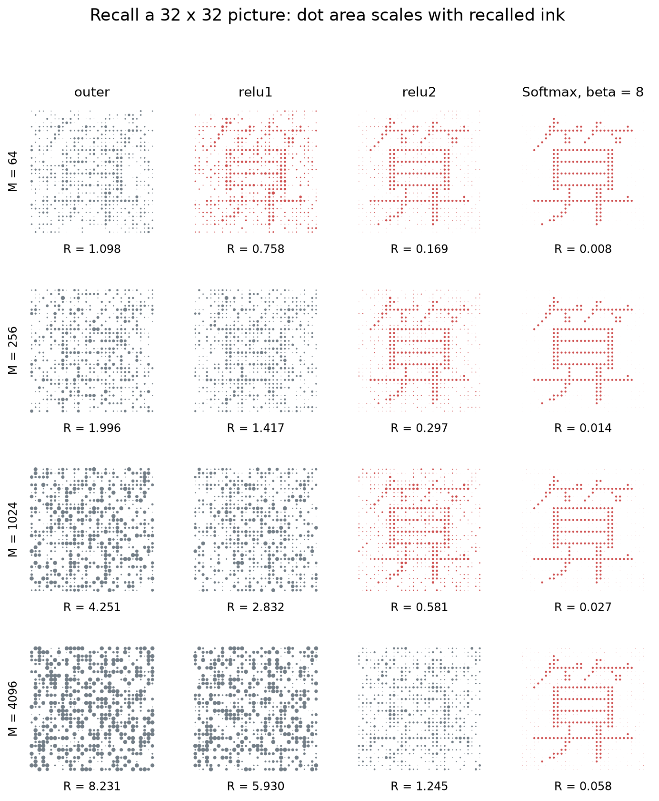

## Part 5 — Train and sample a transformer

`python scripts/part5_transformer.py`

The **328,832-parameter** decoder has learned token/position embeddings, two pre-norm blocks, width 96, four heads of width 24, causal attention, residual connections, a GELU MLP of width 384, final layer norm and untied readout. Every linear map has a bias. Attention scores divide by √24 and masked future weights are exactly zero.

Training uses exactly **6,000 AdamW steps × 32 sequences × 64 predictions**, 12,288,000 training-token presentations. Each example is 65 consecutive training tokens, shifted into inputs and targets. Peak LR is 0.003; 300 warmup steps precede cosine decay to 0.0003. Weight decay is 0.01, seed 1848. Initial weights have standard deviation 0.02; residual output matrices are scaled by 1/√4. No dropout or early stopping is used. Validation monitoring does not select a checkpoint: the final 6,000-step model is evaluated.

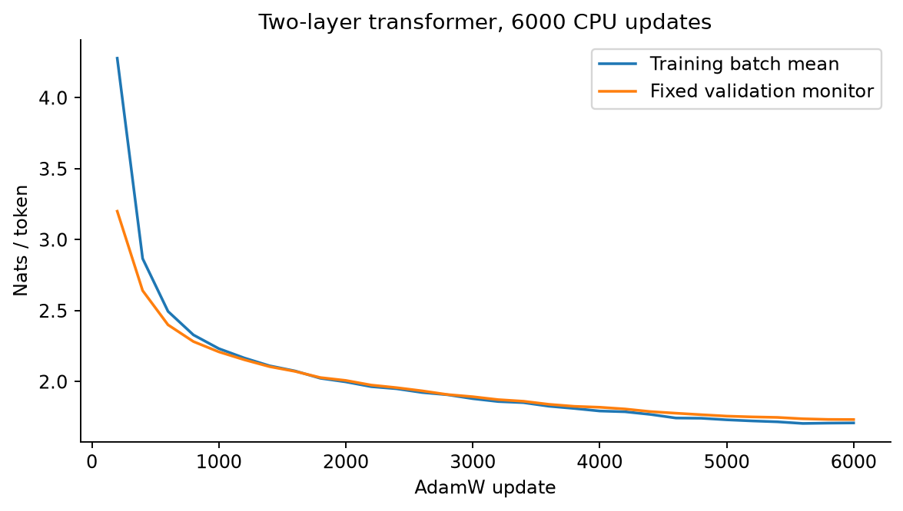

`python scripts/part5_evaluate.py`

Full validation loss is **1.73492 nats/token**, **1.21987 bits/character**, about **6.9% fewer bits** than the best count model. The full stream is scored in consecutive 64-input windows, including the final 20-token suffix for the overall score. Original story character counts are used for every model.

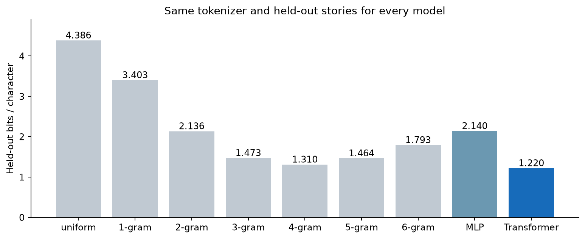

`python scripts/part5_evaluate.py`

The per-position plot uses **16,859 complete windows**, with bands of two standard errors across windows. Mean loss after at least 32 tokens is **1.66046**; the last eight positions average **1.66781**, both below the trigram's 2.09434. The window standard errors are descriptive: adjacent windows can belong to the same story. A one-token predictor cannot make this improvement as context grows.

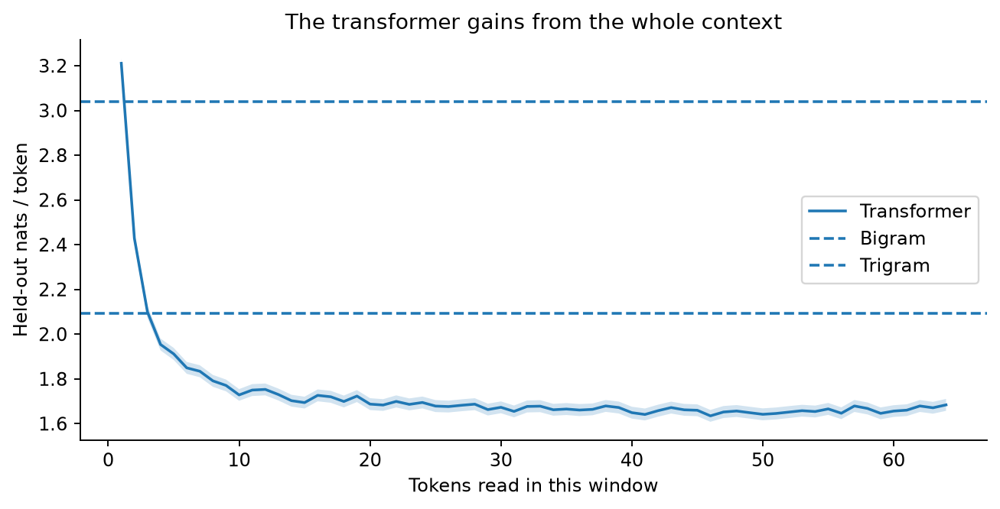

`python scripts/part5_evaluate.py`

Each sampler draws **100,000 tokens** after the fixed prefix `Once upon a time, there was a` (base entropy 2.7525 nats). Generation and this check share the **same JAX categorical draw helper**. Independent NumPy probability transformations supply the chi-square targets. Temperature is applied before truncation; top-p retains the threshold-crossing token.

| Sampler | Settings | Chi-square p |
| :--- | :--- | ---: |
| Temperature | T=0.8 | 0.6238 |
| Top-k | k=20, T=0.8 | 0.7823 |
| Top-p | p=0.9, T=0.8 | 0.9251 |
| Min-p | p=0.1, T=0.7 | 0.5435 |

All exceed 0.001. T=0.0001 always returns argmax; dropping the top-p crossing token fails the test. Self-consistency generates 128 independent sequences of 128 tokens, retaining EOS and continuing to fixed length. Scoring both temperatures with the original T=1 model gives **z=−0.203 at T=1** and **z=−74.54 at T=0.7**, using sequence-level standard errors of the paired surprise-minus-entropy differences.

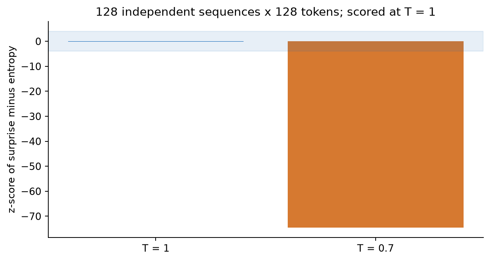

`python scripts/part5_evaluate.py`

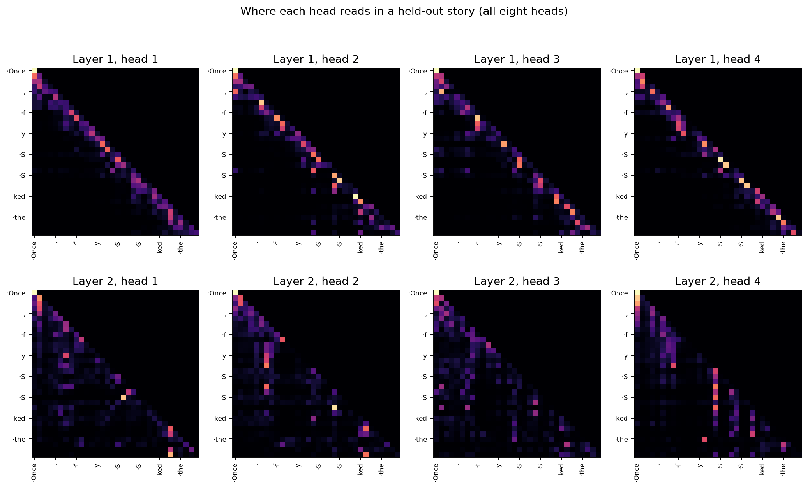

Attention maps show where a head reads, not a causal explanation of its computation. The optional hidden-unit and attention inspections are included, but the acceptance claims depend on the numerical experiments above.

The [60-token openings](evidence/story-openings.txt) compare uniform, unigram, bigram, trigram, MLP and transformer in increasing bits/character, all with seed 1848. Displayed openings and 128-token examples exclude EOS to give a fixed display length; the scoring and self-consistency checks include it. Trigram generation starts after one EOS using a bigram prediction until two history tokens exist. Full sampler-specific text appears in [part5_metrics.json](evidence/part5_metrics.json) and the lab. For example, the transformer starts:

> One day, a little girl named Lucy went for a walk. She saw a big picture with a bitter on a big closer lit up.

Sentence structure improves, but invented words, repetition and weak narrative continuity remain. Lower loss is not evidence of fluent or reliable general-purpose language ability.

In this seed's trigram sample, one rare smoothed token enters an unseen context and the continuation includes byte noise. The sample is retained as drawn; good average held-out likelihood does not guarantee every generated opening reads well.

## Part 6 — Refit Chinchilla and allocate compute

`python scripts/part6_scaling.py`

From 245 published runs, compute D=C/(6N), remove the five highest-loss runs, and fit the remaining 240 with Huber loss on log loss (δ=0.001). **108 L-BFGS starts** search a grid; the best objective is retained. Positive E/A/B are optimized in log coordinates, using float64 and analytic gradients checked by finite differences. The objective is divided by δ solely to improve optimizer stopping, which does not change its minimizer. All **400 bootstrap refits** converge.

| Parameter | Refit | Bootstrap standard error |
| :--- | ---: | ---: |
| E | 1.81722 | 0.02464 |
| A | 477.826 | 118.813 |
| B | 2143.417 | 1420.338 |
| α | 0.34731 | 0.01484 |
| β | 0.36717 | 0.02085 |

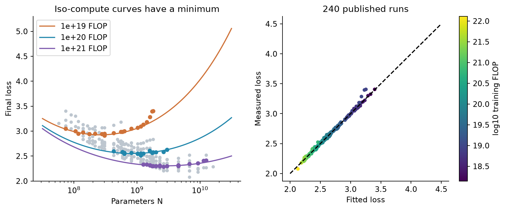

`python scripts/part6_scaling.py`

The refit's mean log residual is **−0.000656**. The paper's printed parameters `(1.69,406.4,410.7,0.34,0.28)` give **+0.016742**, a systematic overprediction of roughly 1.7%.

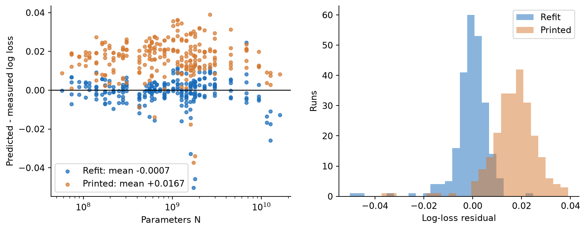

`python scripts/part6_scaling.py`

At fixed C, substitute D=C/(6N) into the law. Stationarity gives
`α A N^(−α) = β B D^(−β)`. Therefore, with
`G=(αA/(βB))^(1/(α+β))`, the optimum is
`N*=G(C/6)^(β/(α+β))` and `D*=(C/6)^(α/(α+β))/G`.

At **C=5.76e23 FLOP**, N*=**73.19 billion**, D*=**1.312 trillion**, giving **17.92 tokens/parameter**, with bootstrap 95% interval **[7.38,35.43]**. The interval includes Chinchilla's 20; it also shows substantial allocation uncertainty. N* and D* grow approximately as C^0.514 and C^0.486. The printed law instead gives **92.65 tokens/parameter**. The plotted 70B/1.4T Chinchilla point uses its nominal C=6ND=5.88e23, distinguished from the sheet's specified 5.76e23 comparison budget.

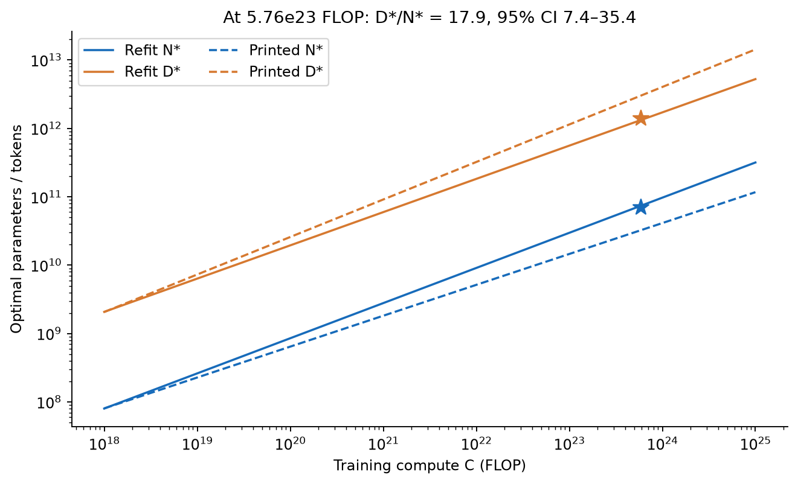

## Verification and publication

`python -m pytest tests -q` runs **34 tests**: hand-derived count probabilities, 54-bit n-gram packing, normalization, correct history at story start, memory projection signal, permutation invariance, truncation boundaries, NumPy MLP forward/backprop, causal masking, parameter count, scheduling, generation through window rollover, finite-difference Huber gradients and optimum stationarity.

`python scripts/verify_results.py` audits **49 numerical criteria** against saved full-run results, including an exact uniform baseline. This complements the tests; it does not replace running the computations. [acceptance.json](evidence/acceptance.json) contains each verdict. Negative controls are intentionally incorrect separate calculations: unnormalized scores, wrong-lag bigram sampling, omitted top-p crossing token, shuffled word rows, correlated keys and T=0.7 samples scored at T=1. They never weaken the valid model's criteria.

The initial 27 tests failed before implementation in commit `0adf7f2`, following specification commit `ca22fab`. Additional sampling/history behavior tests were also observed failing before their implementations. Subsequent commits retain each completed part and its evidence. Independent review checked corpus provenance, raw-run summaries, and NumPy transformer predictions through the 64-token rollover; its identified verification gaps were fixed.

`python scripts/build_web_lab.py` builds [the static lab](../docs/week8-language-lab.html). Browser QA checked desktop and mobile layouts, all 14 loaded figures, controls, lightbox and console errors. Across 64 context/temperature/sampler combinations, browser probabilities agree with independent NumPy targets to **1.0e−15**; details are in [web-validation.json](evidence/web-validation.json).

To repeat the browser checks with Microsoft Edge installed, add the optional Playwright dependency to the active environment and run:

```powershell
uv pip install playwright==1.64.1
python scripts/check_web.py
```

The check covers the header switch, exclusive panels, evidence-only metrics, preserved settings, keyboard navigation, and layouts at 390, 700, 1024 and 1440 pixels. Screenshots stay in ignored `artifacts/web-qa/`. Use `--url https://imgrj.github.io/AMAT5315-2026Fall-Exercise/week8-language-lab.html` to check the deployed page. The header-position check failed against the old layout before implementation.

The source and evidence are published to this exercise repository and its existing GitHub Pages site. Downloads, model checkpoints and raw runs remain excluded from Git.
